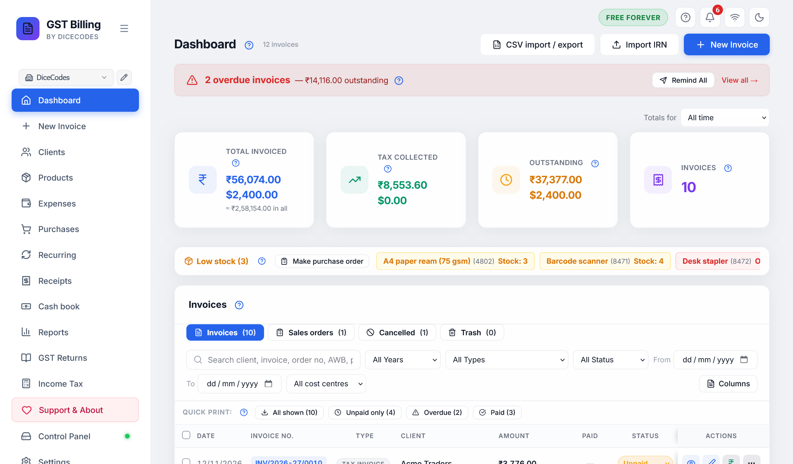
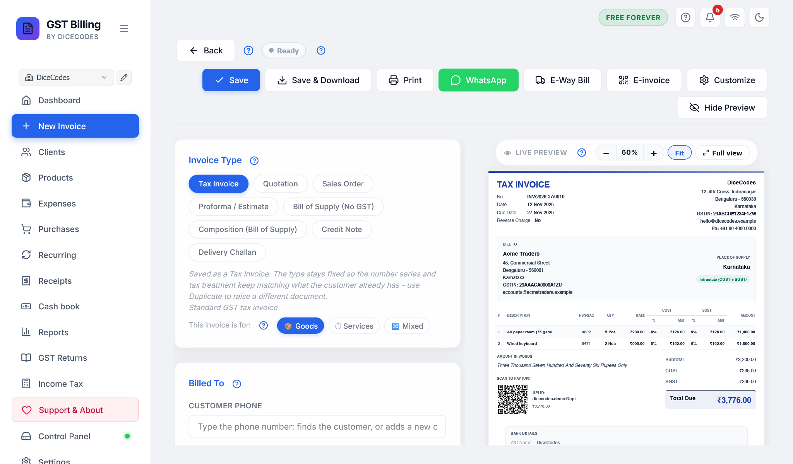
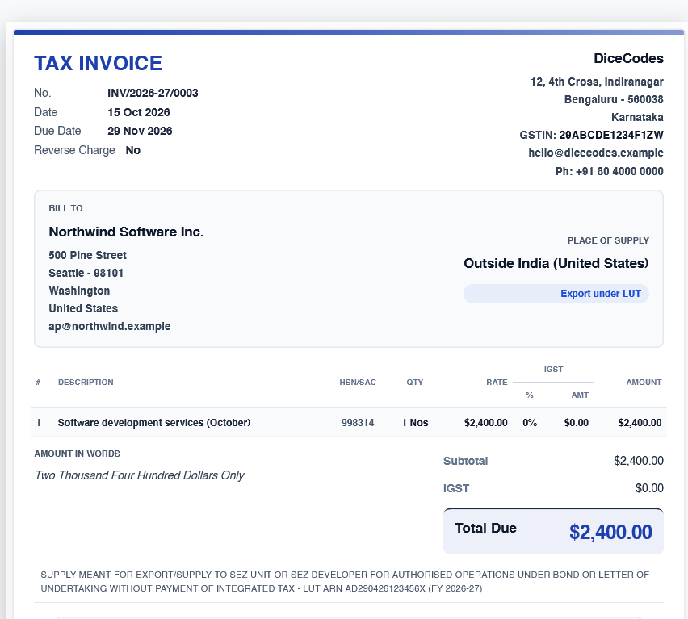
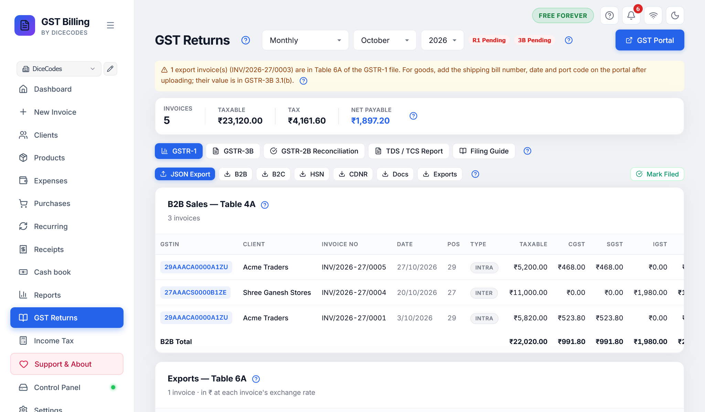
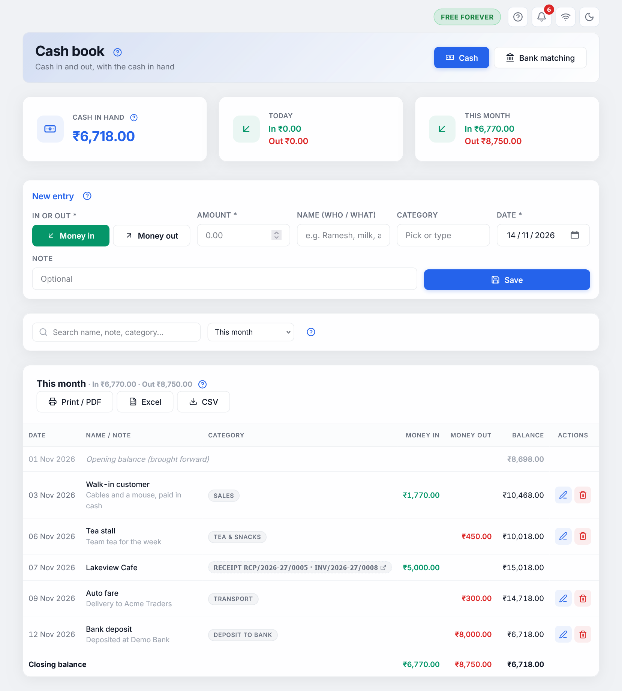
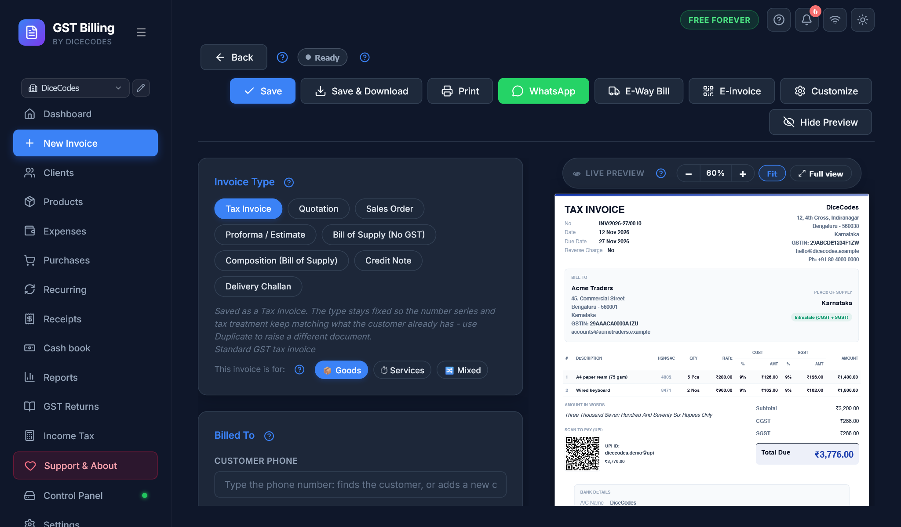

<div align="center">

# Free GST Billing Software — Free Forever, Works Offline, No Tracking

### The only GST invoicing software you'll never have to pay for.

[](LICENSE)
[](#download-and-install)
[](https://github.com/IamRamgarhia/Free-GST-Billing-Software/releases/latest)
[](https://github.com/IamRamgarhia/Free-GST-Billing-Software)
[](#what-it-does)

**GST invoices, GSTR-1 and GSTR-3B files, GSTR-2B matching, TDS / TCS, stock, purchases and reports — free, on your own computer.**

**Free forever. Works offline. No tracking. No ads. No signup.** Open source, so you can [check every claim yourself](#is-it-safe).

**A free invoice maker** for shop owners, freelancers, consultants, traders and small businesses in India: make a GST invoice, quotation, bill of supply, credit note or delivery challan in minutes and save it as a PDF. A free, open-source alternative to Tally, Vyapar, Zoho and myBillBook.

<a href="https://github.com/IamRamgarhia/Free-GST-Billing-Software/releases/latest/download/Free-GST-Billing-Windows-Setup.exe"></a>&nbsp;<a href="#apple-mac"></a>&nbsp;<a href="https://github.com/IamRamgarhia/Free-GST-Billing-Software/releases/latest/download/Free-GST-Billing-Linux-x86_64.AppImage"></a>&nbsp;<a href="https://github.com/IamRamgarhia/Free-GST-Billing-Software/releases/latest"></a>

<a href="https://dicecodes.com/free-gst-software-documentation/"></a>

<sub>Each button always gets the newest version · Windows: the Setup program (about 35 MB) · Apple Mac: one line in Terminal · Linux: the AppImage, or the .deb on the <a href="https://github.com/IamRamgarhia/Free-GST-Billing-Software/releases/latest">release page</a> · <a href="#download-and-install">steps for every system</a></sub>

<a href="#your-first-invoice"></a> <a href="#screenshots"></a> <a href="https://github.com/IamRamgarhia/Free-GST-Billing-Software/issues/new/choose"></a> <a href="https://dicecodes.com/free-gst-software-documentation/support.html"></a>

</div>

---

## What it does

- **Invoices:** tax invoice, quotation, sales order, proforma / estimate, bill of supply, composition bill, credit note and delivery challan. CGST + SGST, IGST or UTGST worked out for you, HSN / SAC, units, discounts, UPI QR code, your logo, signature and stamp.
- **GST returns:** GSTR-1 and GSTR-3B JSON files to upload on the GST portal, GSTR-2B matching against your purchases, e-way bill and e-invoice JSON files.
- **Payments:** record what the customer paid while making the invoice, partly paid bills, receipts, a cash book, and bank statement matching.
- **Stock and purchases:** products with stock, a second unit (Box = 12 Pcs), categories, brands, barcodes, serial numbers; purchase bills, purchase orders and returns to the supplier.
- **Reports:** profit and loss, outstanding and aging, client statements, stock value, product performance, TDS / TCS, income tax.
- **Your way:** 5 invoice layouts and 8 colour designs, labels in English, Hindi, Tamil, Marathi or Bengali, thermal receipts (58 / 80 mm), dark mode, several businesses with separate books, 23 countries and 20 currencies.
- **Safe and yours:** works offline, a backup every day, a trash bin for deleted invoices, an app PIN, and use on your phone or tablet on the same Wi-Fi only if you turn it on.

<details>
<summary><b>See every feature</b></summary>

#### Invoices
- 8 document types: Tax Invoice, Quotation, Sales Order, Proforma / Estimate, Bill of Supply, Composition (Bill of Supply), Credit Note, Delivery Challan. A quotation turns into a sales order or invoice in one click.
- CGST + SGST inside the state, IGST across states, UTGST in union territories; place of supply, SEZ clients, exports under LUT, reverse charge.
- HSN / SAC per line, units (and your own units), a second unit per product, line discounts, and a whole-bill discount before or after GST.
- **Received now**: the payment is recorded while you make the invoice. **Profit on this bill** under the totals (on your screen only, never printed).
- A barcode scanner box on New Invoice, size billing (sq.ft, running feet) for glass and similar work.
- Cancel an invoice and keep its number; the PDF is stamped CANCELLED.
- Your own numbering per document type, recurring invoices, private notes, extra pages, rich-text terms.

#### Look of the invoice
- 5 layouts (Classic, Modern, Minimal, Boxed grid, Tally style) and 8 colour designs; every field can be shown or hidden.
- Labels in English, Hindi, Tamil, Marathi or Bengali, or your own words.
- Logo, signature and stamp; watermark; Original / Duplicate / Triplicate copies; print margins.
- A4 or thermal receipts (58 / 80 mm).

#### GST
- GSTR-1 (B2B, B2C, exports, credit notes, nil-rated and exempt, HSN summary, documents issued) and GSTR-3B, as JSON files for the GST portal and as CSV.
- GSTR-2B matching: import the 2B file and see what matches your purchase bills.
- E-way bill JSON and e-invoice JSON files; a step-by-step filing guide.
- **Close the books** after filing, so nothing in a filed month changes by mistake.

#### Clients, stock and purchases
- Clients with statement and aging PDFs, payment history, credit limit and price levels.
- Products with stock, categories, brands, barcodes and labels, serial numbers / IMEI, stock adjustment, low-stock alerts.
- Purchase bills (with discounts and serial numbers), purchase orders, returns to the supplier (debit notes), payments to suppliers.
- Expenses (paid, unpaid or partly paid), receipts, a cash book and bank statement matching.
- Read a purchase bill from a photo (OCR).

#### Reports
- Profit and loss, outstanding and aging, party outstanding, stock value, client and product performance, TDS / TCS for Form 26Q / 27EQ.
- Income tax: old vs new regime, with the interest under 234B / 234C.

#### Import, export and sharing
- Import clients, products, invoices and purchases from CSV or Excel, and from Vyapar and Tally exports; Flipkart orders become invoices.
- PDF, print, WhatsApp and email; many invoices in one PDF.
- Your own Google Drive for copies (optional).

#### Safety and privacy
- Your books are files on your computer; a backup every day and a trash bin.
- Offline mode: the app never goes online by itself.
- App PIN; hide a business behind its own PIN; an edit history of every change.
- Use on a phone or tablet on the same Wi-Fi: off until you turn it on, and only devices you pair with a QR code and your PIN.

</details>

---

## Download and install

Every link gets the newest version. Your invoices stay on your computer, whichever way you pick. All files are on the [latest release](https://github.com/IamRamgarhia/Free-GST-Billing-Software/releases/latest) page, under **Assets**.

### Windows 10 / 11

1. **[Download `Free-GST-Billing-Windows-Setup.exe`](https://github.com/IamRamgarhia/Free-GST-Billing-Software/releases/latest/download/Free-GST-Billing-Windows-Setup.exe)** (about 35 MB).
2. **Double-click it** in your Downloads folder. If Windows says *"Windows protected your PC"*, click **More info**, then **Run anyway** (the Setup is not signed yet; nothing is wrong with it).
3. **Your books:** first time? Leave *Start new books* ticked. Already using the app? Setup finds it and asks whether to keep your books where they are or copy them. **Your old folder is never changed or deleted.**
4. **Click Install, then Finish.** The app opens in its own window.

No administrator password and nothing else to install. **Updates:** the app shows *Update to vX* → **Update Now**. **Removing:** Windows **Settings → Apps → Installed apps → Free GST Billing → Uninstall** (your books are kept unless you choose to delete them). Full guide: [Install on Windows](https://dicecodes.com/free-gst-software-documentation/install.html).

### Apple Mac

1. Open **Terminal**: press **Cmd + Space**, type *Terminal*, press **Return**.
2. Paste this line and press **Return**:

   ```bash
   curl -fsSL https://raw.githubusercontent.com/IamRamgarhia/Free-GST-Billing-Software/main/install.sh | bash
   ```
3. It installs in a few minutes and opens the app. macOS shows no warning. From then on, open **Free GST Billing** from Launchpad or the Dock. To update, use **Update** in the app, or paste the same line again; your books are kept.

For Intel and Apple silicon Macs, macOS 11 or newer. Full guide: [Install on a Mac](https://dicecodes.com/free-gst-software-documentation/install-mac.html).

<details>
<summary><b>Linux: Ubuntu, Linux Mint, Debian (.deb) or any 64-bit Linux (AppImage)</b></summary>

**.deb (Ubuntu, Linux Mint, Debian)**
1. On the [latest release](https://github.com/IamRamgarhia/Free-GST-Billing-Software/releases/latest) page, under **Assets**, download **`free-gst-billing_<version>_amd64.deb`**.
2. Double-click it, or in a Terminal: `sudo apt install ~/Downloads/free-gst-billing_*_amd64.deb`
3. Open **Free GST Billing** from your applications menu.

**AppImage (any 64-bit Linux)**
1. **[Download `Free-GST-Billing-Linux-x86_64.AppImage`](https://github.com/IamRamgarhia/Free-GST-Billing-Software/releases/latest/download/Free-GST-Billing-Linux-x86_64.AppImage)**.
2. Right-click it → **Properties → Permissions** → tick *Allow executing file as program* (or `chmod +x Free-GST-Billing-Linux-x86_64.AppImage`).
3. Double-click it.

Both keep your books in `~/.local/share/free-gst-billing-data`. To update, install or use the new file the same way. Full guide: [Install on Linux](https://dicecodes.com/free-gst-software-documentation/install-linux.html).

</details>

<details>
<summary><b>NAS or home server (Docker)</b></summary>

1. Download **`docker-compose.yml`** from the [latest release](https://github.com/IamRamgarhia/Free-GST-Billing-Software/releases/latest). It uses the image `ghcr.io/iamramgarhia/free-gst-billing`.
2. Put your own 6 or 8 digit PIN in `FGSB_PIN`, then run `docker compose up -d`.
3. Open the pairing link that `docker logs free-gst-billing` shows, on your phone or PC.

Every device is paired with a one-time code and the PIN, over HTTPS; nothing gets in without pairing. Never forward its port on your router. **To update:** put the new version in the `image:` line, then `docker compose pull` and `docker compose up -d`; the books stay in the volume. Step by step: [On a NAS: Docker](https://dicecodes.com/free-gst-software-documentation/install-linux.html#nas-docker).

</details>

<details>
<summary><b>Other ways: one line on Windows, the ZIP, or from the source code</b></summary>

**One line on Windows** (no download box to click through): press **Windows + R**, paste, press **Enter**:

```
powershell -ExecutionPolicy Bypass -c "[Net.ServicePointManager]::SecurityProtocol='Tls12'; irm https://raw.githubusercontent.com/IamRamgarhia/Free-GST-Billing-Software/main/install.ps1 | iex"
```

It installs to `%LOCALAPPDATA%\Programs\Free GST Billing`, adds the icons and opens the app. The same line updates or repairs it; your data is backed up first and never touched.

**The ZIP** (Linux or a NAS without Docker, or a Windows PC where you would rather not install anything):
1. [Download `Free-GST-Billing.zip`](https://github.com/IamRamgarhia/Free-GST-Billing-Software/releases/latest/download/Free-GST-Billing.zip) and **extract it first** (right-click → Extract All).
2. Double-click **Free GST Billing - WINDOWS** (or **Free GST Billing - LINUX.sh**) and click **Install**.
3. From then on, open the app from the **Free GST Billing** icon.

**From the source code** (developers):

```bash
git clone https://github.com/IamRamgarhia/Free-GST-Billing-Software.git
cd Free-GST-Billing-Software
npm install
npm start      # builds and serves on http://localhost:47371
npm run dev    # live reload on http://localhost:5173
```

</details>

### The Free GST Billing icon

Every install puts a **Free GST Billing** icon on your computer (the blue **B**). Click it every day: it starts the app if needed and opens it. Update, backup, restart and stop are in the app's **⚙ Control Panel**. Don't use the browser's own *Install app* button: that icon cannot start the app.

---

## Is it safe?

- **Your data never leaves your computer.** Invoices, clients and settings are plain files on your computer. No cloud server of ours, nothing to leak.
- **No account, no login, no ads, no tracking.** No analytics, and none of your business data is ever sent to us.
- **Other computers cannot open it.** The app answers only this computer (`127.0.0.1`).
- **Phones only if you say so, and only yours.** *Use on phone or tablet* (Settings → Privacy & Security) is off until you turn it on. On, it answers your own Wi-Fi only, encrypted, and only devices you paired with a QR code **and** your PIN. [How it is kept safe](https://dicecodes.com/free-gst-software-documentation/phone.html#how-safe)
- **Open source — check every line.** The full code is here under the MIT licence.
- **No admin rights needed**, and a backup of your books every day.

<details>
<summary><b>Check it yourself in 2 minutes, and see when it uses the internet</b></summary>

1. **Switch your internet off** and open the app. Make an invoice, download the PDF, print it, open Reports. **Everything works.**
2. **Turn on Offline mode** in **Settings → Privacy & Security**. From then on the app **never goes online by itself**. You can still update whenever you choose.
3. **Watch it, or block it.** Windows Resource Monitor (`resmon` → Network) shows no outside connections with Offline mode on. Block it in the firewall if you like: the app keeps working, only the update check stops.

| What | When | Offline mode |
|---|---|---|
| Check for a new version (asks GitHub for the version number; nothing about you is sent) | A few seconds after opening, then every 6 hours | **Stopped** |
| The public supporters list (read from GitHub; nothing is sent) | When Support & About shows | **Stopped** |
| Your own Google Drive | Only if you set it up | Automatic copies **stopped** |
| Installing and updating | When you click Install / Update | Only when you click |
| Help pages, Report a problem, WhatsApp, GST portal links | When you click them | Only when you click |
| Phone / tablet access: **your own Wi-Fi only, never the internet** | Only if you turn it on | Not affected |

**That is the complete list.** [Every address the app connects to](https://dicecodes.com/free-gst-software-documentation/security.html)

</details>

---

## Screenshots

Real screens from the app, with a made-up demo business (DiceCodes, fake GSTIN and bank details).

<table>
  <tr>
    <td width="50%"><br><sub><b>Dashboard</b>: overdue invoices, totals, low stock and every invoice in one list.</sub></td>
    <td width="50%"><br><sub><b>New invoice</b>: fill in the form, the preview updates as you type.</sub></td>
  </tr>
  <tr>
    <td width="50%"><br><sub><b>Exports under LUT</b>: bill in dollars, no IGST, the declaration printed for you.</sub></td>
    <td width="50%"><br><sub><b>GST returns</b>: GSTR-1 and GSTR-3B built from your invoices.</sub></td>
  </tr>
  <tr>
    <td width="50%"><br><sub><b>Cash book</b>: cash in and out, with the cash in hand.</sub></td>
    <td width="50%"><br><sub><b>Dark mode</b>: invoices still print in normal colours.</sub></td>
  </tr>
</table>

More screenshots, next to the steps they show, in the [documentation](https://dicecodes.com/free-gst-software-documentation/).

---

## Your first invoice

<details>
<summary><b>From install to a paid invoice in 5 minutes</b></summary>

1. **Install** for your computer ([Download and install](#download-and-install)). Do **not** use GitHub's green *Code → Download ZIP* button: that is the source code, not the app.
2. **Set up your business.** The welcome steps open by themselves: pick **India**, **Outside India** or **Both**, then your business name, address, GSTIN (leave it empty if you are not registered) and your bank and UPI details. Everything can be changed later in **Settings**.
3. **Make the invoice.** Click **New Invoice**. Pick the type (**Tax Invoice** for GST sales, **Bill of Supply** if you charge no GST, **Quotation** for a price offer). Type the client's name (a saved client fills in by itself), then each item with its quantity, rate and GST %.
4. **Save it.** Click **Save PDF**: the invoice is saved with the next number and the PDF downloads. **Print** and **WhatsApp** are next to it.
5. **Get paid.** Type the amount in **Received now** while making the invoice, or later click the **₹** button on its row on the Dashboard. The status follows: Unpaid → Partly paid → Paid. Overdue invoices turn red.

Next: **GST Returns** in the sidebar makes the GSTR-1 and GSTR-3B files for the month. Every screen is explained in the [documentation](https://dicecodes.com/free-gst-software-documentation/); the **?** next to each section opens its page.

</details>

---

## Filing your own GST returns

Enter your invoices and purchase bills as usual. At the end of the month open **GST Returns**: check GSTR-1, download its JSON and upload it on gst.gov.in; then check GSTR-3B and download its JSON or copy the figures. GSTR-2B matching shows which purchase bills your suppliers have filed. A step-by-step filing guide is in the app, including nil returns. **Close the books** after filing so a filed month cannot change by mistake.

---

## Roadmap

One update every Saturday. Dates are plans: if a week fills up, the least-used item moves to the next week, and we say so on its issue.

**Next:** **21 November**: an MRP column ([#189](https://github.com/IamRamgarhia/Free-GST-Billing-Software/issues/189), [#192](https://github.com/IamRamgarhia/Free-GST-Billing-Software/issues/192)), a statement for each supplier ([#148](https://github.com/IamRamgarhia/Free-GST-Billing-Software/issues/148), [#194](https://github.com/IamRamgarhia/Free-GST-Billing-Software/issues/194)), add GSTR-2B bills as purchase bills ([#175](https://github.com/IamRamgarhia/Free-GST-Billing-Software/issues/175)), invoices that always fit A4 ([#188](https://github.com/IamRamgarhia/Free-GST-Billing-Software/issues/188)), and easier phone pairing and updates. **28 November**: TDS / TCS part 2 ([#180](https://github.com/IamRamgarhia/Free-GST-Billing-Software/issues/180)). **December**: a balance sheet and separate bank and cash ledgers ([#148](https://github.com/IamRamgarhia/Free-GST-Billing-Software/issues/148), [#189](https://github.com/IamRamgarhia/Free-GST-Billing-Software/issues/189)).

<details>
<summary><b>Just released, waiting for more requests, and not planned</b></summary>

**Just released: v1.10.85 (14 November 2026)**
- Use the app on a phone or tablet on the same Wi-Fi ([#142](https://github.com/IamRamgarhia/Free-GST-Billing-Software/issues/142), [#115](https://github.com/IamRamgarhia/Free-GST-Billing-Software/issues/115)), and a Docker image for a NAS
- Sales orders with a dispatch status ([#135](https://github.com/IamRamgarhia/Free-GST-Billing-Software/issues/135), [#112](https://github.com/IamRamgarhia/Free-GST-Billing-Software/issues/112)); purchase returns / debit notes ([#168](https://github.com/IamRamgarhia/Free-GST-Billing-Software/issues/168))
- Barcodes: scan on New Invoice, print labels ([#137](https://github.com/IamRamgarhia/Free-GST-Billing-Software/issues/137), [#158](https://github.com/IamRamgarhia/Free-GST-Billing-Software/issues/158))
- Payment while making the invoice ([#185](https://github.com/IamRamgarhia/Free-GST-Billing-Software/issues/185), [#187](https://github.com/IamRamgarhia/Free-GST-Billing-Software/issues/187)), profit on each bill, bank statement matching ([#175](https://github.com/IamRamgarhia/Free-GST-Billing-Software/issues/175))
- Box = 12 Pcs units, categories and brands, stock adjustment ([#148](https://github.com/IamRamgarhia/Free-GST-Billing-Software/issues/148), [#142](https://github.com/IamRamgarhia/Free-GST-Billing-Software/issues/142)); price levels, credit limit, statement preview and payment history ([#157](https://github.com/IamRamgarhia/Free-GST-Billing-Software/issues/157))
- Discount before GST ([#190](https://github.com/IamRamgarhia/Free-GST-Billing-Software/issues/190)), purchase line discount and serial numbers ([#171](https://github.com/IamRamgarhia/Free-GST-Billing-Software/issues/171), [#160](https://github.com/IamRamgarhia/Free-GST-Billing-Software/issues/160)), running-feet lines ([#140](https://github.com/IamRamgarhia/Free-GST-Billing-Software/issues/140))
- TDS / TCS under the Income-tax Act, 2025, part 1 ([#180](https://github.com/IamRamgarhia/Free-GST-Billing-Software/issues/180)), close the books, hide a business behind a PIN ([#125](https://github.com/IamRamgarhia/Free-GST-Billing-Software/issues/125)), Flipkart order import ([#172](https://github.com/IamRamgarhia/Free-GST-Billing-Software/issues/172)), paid / unpaid expenses ([#165](https://github.com/IamRamgarhia/Free-GST-Billing-Software/issues/165))

**Waiting for more requests** (add a 👍 to the issue if you need it; we build first what most users ask for): staff logins with roles ([#155](https://github.com/IamRamgarhia/Free-GST-Billing-Software/issues/155)), warranty tracking ([#122](https://github.com/IamRamgarhia/Free-GST-Billing-Software/issues/122)), batch and expiry ([#192](https://github.com/IamRamgarhia/Free-GST-Billing-Software/issues/192)).

**Not planned:** anything that needs an online account, a paid GST provider (GSP) or a server of ours and would send your data out of your computer: filing or fetching data directly from the GST portal ([#139](https://github.com/IamRamgarhia/Free-GST-Billing-Software/issues/139), [#173](https://github.com/IamRamgarhia/Free-GST-Billing-Software/issues/173)), live bank feeds, payment-gateway links, an online store, cloud sync. Also a separate Android app (use the app on your phone over Wi-Fi instead) and a separate POS screen.

</details>

- 🐛 **[Report a problem](https://github.com/IamRamgarhia/Free-GST-Billing-Software/issues/new?template=bug_report.yml)**: the version, your computer and the steps help us fix it the same week.
- 💡 **[Ask for a feature](https://github.com/IamRamgarhia/Free-GST-Billing-Software/issues/new?template=feature_request.yml)**: we read every request each week. Add a 👍 to an [open request](https://github.com/IamRamgarhia/Free-GST-Billing-Software/issues) to vote for it.

Every change: [CHANGELOG.md](./CHANGELOG.md), also in the app under **Support & About → What's new**.

---

## Why is it free?

- **It stays free, forever.** No paid version, no locked features, no ads, no tracking. It is MIT-licensed open source, so the app you have today can always be used, copied and kept by anyone.
- **It costs very little to keep going.** The app runs on your computer: there are no servers or cloud bills for us to pay.
- **How we earn:** paid work for businesses that want it (custom features, setup and moving data in, support plans) and people who choose to support the project.

**Support the project:** ⭐ star this repo · tell another business · [report a bug or ask for a feature](https://github.com/IamRamgarhia/Free-GST-Billing-Software/issues/new/choose) · 💛 UPI, any amount: `princeramgarhiaa-1@okaxis` (also as a QR code in the app, under **Support & About**).

**Work with DiceCodes:** custom software and web apps, customising this app for your business, setup and data migration, support plans. [contact@dicecodes.com](mailto:contact@dicecodes.com)

---

## Troubleshooting

<details>
<summary><b>Find the message you see</b></summary>

None of these touch your invoices.

| You see | What to do |
|---|---|
| **"Windows protected your PC"** | The Setup isn't code-signed yet. Click **More info → Run anyway**. |
| **"Some files are missing"** or **"extract the ZIP first"** | The app can't run from inside the ZIP. Right-click the ZIP → **Extract All**, open the new folder, then double-click **Free GST Billing - WINDOWS**. |
| **"Cannot connect to server"**, **"This site can't be reached"**, or a blank page | The app isn't running. Click the **Free GST Billing** icon. |
| **"Still starting…"** | The first start after an install or update is slow while antivirus checks the new files. Wait a minute, then open the app from its icon again. |
| The update finished but nothing changed | Reload the page with **Ctrl + F5**. |
| **"The app cannot write to its own folder"** | Don't keep the ZIP copy in `C:\Program Files`. Move the folder to Documents or `D:\` and open it from there. |
| **"Free GST Billing is already installed on this computer, in: …"** | You extracted a new ZIP into a new folder. Your invoices are in the folder it names: click **Update the installed copy**, then delete the new folder. |
| Forgot the app PIN | In the app folder, create an empty text file named `RESET-PIN` and reload the app. The PIN is removed; invoices aren't touched. |
| Mac / Linux: **"Node.js … is too old"** or **"not installed"** | The message lists the command for your system (`apt`, `dnf`, `pacman`, `apk`, `brew`). Install Node.js 20, then run the install again. |

**Still stuck?** [Report a problem](https://github.com/IamRamgarhia/Free-GST-Billing-Software/issues/new?template=bug_report.yml) with the message and a screenshot (hide your GSTIN and bank details). More answers: [troubleshooting guide](https://dicecodes.com/free-gst-software-documentation/troubleshooting.html).

</details>

---

## Questions

<details>
<summary><b>Is it really free?</b></summary>

Yes. MIT-licensed open source: no subscription, no premium tier, no trial that expires, no limits.

</details>

<details>
<summary><b>Will my data be sent to the cloud?</b></summary>

No. Your invoices, clients, products and settings are files on your computer. Nothing leaves it unless you turn on the optional Google Drive copy, and then it goes to *your own* Drive.

</details>

<details>
<summary><b>Can I file GST returns directly from the app?</b></summary>

The app makes the GSTR-1 and GSTR-3B files in the GST portal's format, and the GSTR-2B matching. You upload them on gst.gov.in yourself; no third party in between. Filing straight from the app would need a paid GST provider and would send your data out, so it is not planned.

</details>

<details>
<summary><b>Does it work without internet?</b></summary>

Yes. Only installing, updates, help pages and the optional Google Drive copy use the internet. Turn on **Offline mode** and it never goes online by itself.

</details>

<details>
<summary><b>Can I bill clients abroad?</b></summary>

Yes: 23 countries and 20 currencies, with the right tax name (GST, VAT, SST and others) and the amount in words in that currency. Exports from India under LUT print the declaration for you. Choose **Outside India** or **Both** in the first-run setup, or later in **Settings**.

</details>

<details>
<summary><b>Can I use it as a simple invoice maker?</b></summary>

Yes. Add your business once, pick a client and items, and save the invoice as a PDF or print it. Not GST-registered? Use **Bill of Supply**. Quotations turn into an invoice in one click.

</details>

<details>
<summary><b>Can I run several businesses?</b></summary>

Yes, as many as you like, each with its own GSTIN, bank accounts, logo, numbering and separate books (**Settings → Profiles**). Switch from the business name at the top of the sidebar.

</details>

<details>
<summary><b>What happens to my data when the app updates?</b></summary>

Updates replace only the app's own files. Your invoices, clients, products, settings and saved PDFs are never touched, and a backup is made first.

</details>

<details>
<summary><b>Is there a mobile app?</b></summary>

Not as a separate app. Since v1.10.85 you can use the app from a phone or tablet on the same Wi-Fi as your computer: [Use on a phone or tablet](https://dicecodes.com/free-gst-software-documentation/phone.html).

</details>

<details>
<summary><b>Can I bring my data from Tally, Vyapar or Excel?</b></summary>

Yes. Clients, products, invoices and purchases import from CSV or Excel (.xlsx), and from Vyapar and Tally exports (**Dashboard → CSV import / export**). A template is there to download.

</details>

<details>
<summary><b>Can I put it online (Railway, Render, a web server)?</b></summary>

Not yet. The app has no logins on its server, so anyone who found the address could read your books. [Why, and what to do instead](https://dicecodes.com/free-gst-software-documentation/security.html#host-online). For other devices, use it on your own Wi-Fi.

</details>

---

## For developers

<details>
<summary><b>Tech stack, project layout, Google Drive setup and contributing</b></summary>

**Tech stack:** React 19 and Vite 7 (the screens), Express 5 on Node.js (the local server), jsPDF + html2canvas (PDFs), tesseract.js (reading bill photos), qrcode, DOMPurify. Data is stored as JSON files; there is no database.

**Project layout**

```
server.js          the local server (port 47371)
src/               the app: App.jsx, components/, utils/, store.js
tests/             the browser test suite (smoke.mjs)
scripts/           builds and unit tests
docs-site/         the online documentation
installer/         the Windows Setup
packaging/         the Linux packages and the Docker image
release-templates/ the ZIP's launchers and scripts
data/              your books when run from the source (not in git)
```

**Google Drive (optional):** in the [Google Cloud Console](https://console.cloud.google.com/) create a project, enable the **Google Drive API**, create an **OAuth 2.0 Client ID** (Web application) with `http://localhost:47371` as an authorised JavaScript origin, then paste the Client ID in **Settings → Data & Backups** and click **Connect Google Drive**.

**Contributing:** fork the repository, make a branch, commit, and open a pull request. Bug reports, feature ideas and documentation fixes are welcome on [Issues](https://github.com/IamRamgarhia/Free-GST-Billing-Software/issues).

</details>

---

## Contact

- **Email:** [contact@dicecodes.com](mailto:contact@dicecodes.com)
- **Report a problem:** [bug report form](https://github.com/IamRamgarhia/Free-GST-Billing-Software/issues/new?template=bug_report.yml) · **Ask for a feature:** [feature form](https://github.com/IamRamgarhia/Free-GST-Billing-Software/issues/new?template=feature_request.yml)
- **Releases:** [GitHub Releases](https://github.com/IamRamgarhia/Free-GST-Billing-Software/releases) · **Documentation:** [dicecodes.com/free-gst-software-documentation](https://dicecodes.com/free-gst-software-documentation/)

## License

[MIT License](LICENSE): free to use, change and share.

---

<div align="center">

[**⬇ Download**](#download-and-install) &nbsp;·&nbsp; [⭐ **Star on GitHub**](https://github.com/IamRamgarhia/Free-GST-Billing-Software) &nbsp;·&nbsp; [📖 **Documentation**](https://dicecodes.com/free-gst-software-documentation/) &nbsp;·&nbsp; [🐛 **Report a problem**](https://github.com/IamRamgarhia/Free-GST-Billing-Software/issues)

<sub>Free GST billing software India · Free GST invoice software for small business · Open source GST billing software · Free alternative to Tally Prime Vyapar Zoho Books ClearTax myBillBook Marg ERP · No subscription invoice software · Offline billing software India · GSTR-1 GSTR-3B filing software free · GSTR-2B reconciliation tool free · TDS Form 26Q TCS Form 27EQ software · Section 194Q 206C(1H) TCS calculator with ₹50 lakh threshold · UTGST invoice software · CGST SGST IGST auto calculator · E-way bill JSON generator free · HSN SAC code invoice generator · Bill of Supply generator · Delivery Challan software · Credit Note Debit Note software · Proforma invoice estimate software · Composition scheme invoice · UPI QR invoice maker · Thermal receipt printer software 58mm 80mm · Direct vector thermal print software · POS billing software free India · Retail shop kirana billing software · Restaurant cafe billing software · Freelancer consultant invoice software India · Multi-currency invoice generator (USD EUR GBP AED SGD AUD) 23 countries · Country-aware VAT SST MwSt TVA PPN tax labels · Recurring invoice software · Payment receipt voucher software · Bulk PDF invoice export · Google Drive backup billing software · Automatic daily backup + Trash bin · Multi-business multi-GSTIN switcher · Multi-language invoice Hindi Tamil Marathi Bengali · Dark mode PWA billing app · Rich-text Terms & Conditions with 13 India presets · OCR bill scan tesseract · Ctrl+K command palette · Split-view live PDF preview · Income Tax (ITR) computation old vs new regime 234B 234C · Client credit balance carry-forward · Watermark DUPLICATE DRAFT PDF · Rule 48 multi-copy (Original Duplicate Triplicate) · WhatsApp share invoice PDF · Self-file GST return software · GST invoice software without subscription · No signup no login billing software · Vyapar alternative open source · Tally alternative free · Zoho Books alternative · ClearTax alternative · myBillBook alternative · Marg ERP alternative · Made in India</sub>

Made in India 🇮🇳 · [DiceCodes](https://dicecodes.com)

</div>
