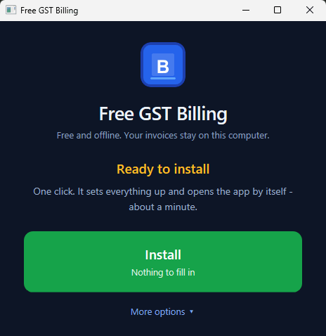
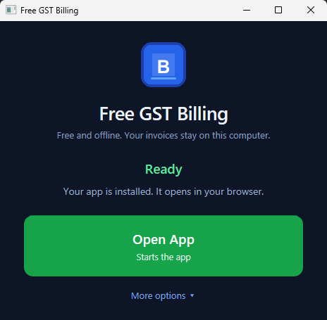
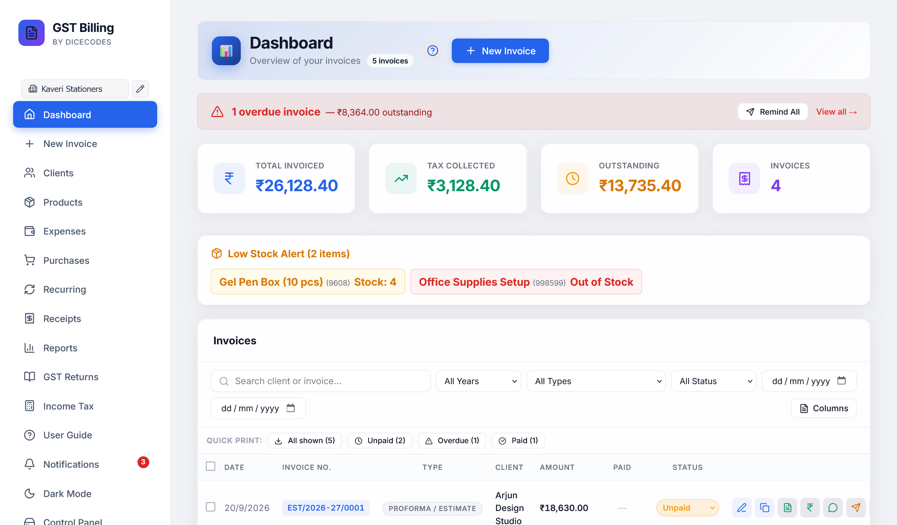
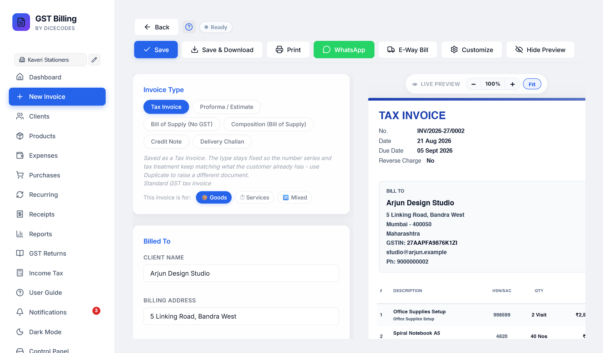
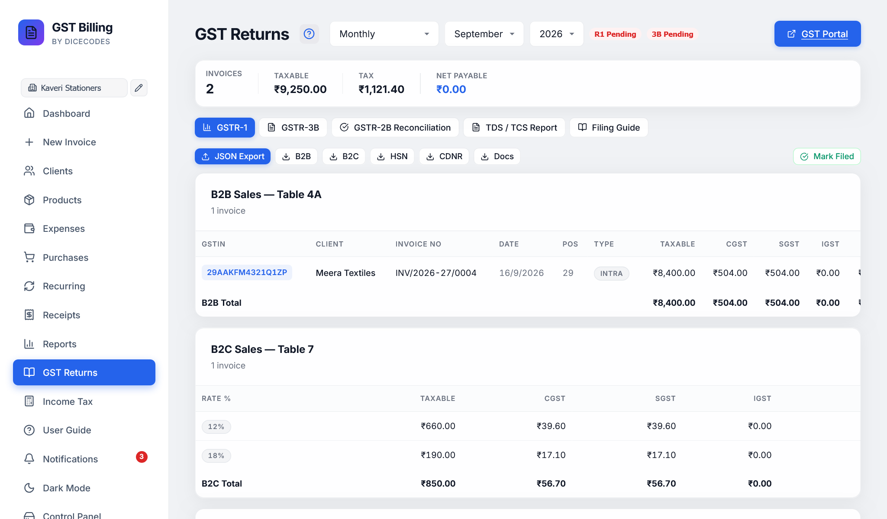

<div align="center">

# Free GST Billing Software — Free Forever, Works Offline, No Tracking

### The only GST invoicing software you'll never have to pay for.

[](LICENSE)
[](#quick-start--installation)
[](https://github.com/IamRamgarhia/Free-GST-Billing-Software/releases/latest)
[](#the-free-gst-billing-icon)
[](https://github.com/IamRamgarhia/Free-GST-Billing-Software)
[](#key-features)
[](#clipboard-gst-compliance--filing)

**Create GST-compliant invoices, file GSTR-1 / GSTR-3B / GSTR-2B reconciliation, track TDS / TCS, bill international clients in 22 currencies, manage inventory — all without paying a single rupee. Ever.**

**Free forever. Works on your computer, even offline. No tracking. No ads. No signup.**

Your data never leaves your computer. No cloud and no limits. Open source, so you can [check every claim yourself](#dont-trust-us-check-it-in-2-minutes).

**A free invoice builder and invoice maker** for shop owners, freelancers, consultants, traders and small businesses in India: make a GST invoice, quotation (proforma / estimate), bill of supply, credit note or delivery challan in minutes and save it as a PDF. Free billing software and a free, open-source alternative to Tally, Vyapar, Zoho and myBillBook.

<a href="https://github.com/IamRamgarhia/Free-GST-Billing-Software/releases/latest/download/Free-GST-Billing-Windows-Setup.exe"></a>&nbsp;<a href="https://github.com/IamRamgarhia/Free-GST-Billing-Software/releases/latest/download/Free-GST-Billing.zip"></a>&nbsp;<a href="https://github.com/IamRamgarhia/Free-GST-Billing-Software/releases/latest/download/Free-GST-Billing-Linux-x86_64.AppImage"></a>&nbsp;<a href="https://github.com/IamRamgarhia/Free-GST-Billing-Software/releases/latest"></a>

<a href="https://dicecodes.com/free-gst-software-documentation/"></a>

<sub>Each button always gets the newest version · Windows: the Setup program (about 35 MB) · macOS: the ZIP (about 25 MB) · Linux: the AppImage, or the .deb on the <a href="https://github.com/IamRamgarhia/Free-GST-Billing-Software/releases/latest">release page</a> · <a href="#download-and-install">step-by-step for every system</a></sub>

<a href="#quick-start--installation"></a> <a href="#your-first-invoice-in-5-minutes"></a> <a href="#screenshots"></a> <a href="https://github.com/IamRamgarhia/Free-GST-Billing-Software/releases"></a> <a href="https://github.com/IamRamgarhia/Free-GST-Billing-Software/issues/new/choose"></a> <a href="https://dicecodes.com/free-gst-software-documentation/support.html"></a>

</div>

---

## 🔒 Is it safe? Yes — here is why

- **Your data never leaves your computer.** Invoices, clients and settings are plain files in the app's own folder. No cloud server of ours, nothing to leak.
- **No account, no login, no ads, no tracking.** No analytics, and none of your business data is ever sent to us.
- **Other computers cannot open it.** The app's server listens only on `127.0.0.1`, this computer itself, and refuses requests from other websites.
- **Open source — check every line.** The full code is right here under the MIT licence; the release ZIP is built from it with `npm run release:zip`.
- **No admin rights needed.** It installs into your own user folder, and your data is backed up automatically every day.
- **Works offline, and says what it connects to.** On its own it contacts only GitHub (the update check and the public supporters list) — plus your own Google Drive, only if you connect it. Even its font is built in.

### Don't trust us. Check it in 2 minutes.

1. **Switch your internet off** (Wi-Fi off, or unplug the cable) and open the app. Make an invoice, download the PDF, print it, open Reports. **Everything works.** Nothing the app does with your books needs the internet.
2. **Turn on Offline mode** in **Settings → Privacy & Security → Privacy & internet**. From then on the app **never goes online by itself**: no update check, no supporters list, no automatic copy to Google Drive. You can still update whenever you choose.
3. **Watch it, or block it.** Windows Resource Monitor (`resmon` → Network) shows the app's `node.exe` making no outside connections with Offline mode on. You can even block it in the firewall: the app keeps working, only the update check stops.

### When does it use the internet?

| What | When | Offline mode |
|---|---|---|
| Check for a new version (asks GitHub for the version number; nothing about you is sent) | By itself, a few seconds after opening, then every 6 hours | **Stopped** |
| The public supporters list (read from GitHub; nothing is sent) | By itself, when Support & About shows | **Stopped** |
| Your own Google Drive | Only if you set it up | Automatic copies **stopped** |
| Installing and updating | When you click Install / Update | Only when you click |
| Help pages, Report a problem, WhatsApp, GST portal links | When you click them | Only when you click |

**That is the complete list.** No analytics, no ads, no error-tracking service, and no server of ours that receives your data.

**[Read the full answer: every address the app connects to, and more ways to check →](https://dicecodes.com/free-gst-software-documentation/security.html)**

---

## Download and install

Pick your computer. Every link below always gets the newest version. Your invoices stay on your computer, whichever you pick. All files are also on the [latest release](https://github.com/IamRamgarhia/Free-GST-Billing-Software/releases/latest) page, under **Assets**.

### Windows 10 / 11: the Setup program (recommended)

1. **[Download `Free-GST-Billing-Windows-Setup.exe`](https://github.com/IamRamgarhia/Free-GST-Billing-Software/releases/latest/download/Free-GST-Billing-Windows-Setup.exe)** (about 35 MB).
2. **Double-click it** in your Downloads folder. If Windows says *"Windows protected your PC"*, click **More info**, then **Run anyway** (the Setup is new and not yet signed; nothing is wrong with it).
3. **Your books:** first time? Leave *Start new books* ticked. Already using the ZIP or the one-line install? Setup finds it and asks: keep using your books where they are, or copy them to `C:\Users\<your name>\Free GST Billing`. **Your old folder is never changed or deleted.**
4. **Click Install, then Finish.** The app opens full screen in its own window. Closing it keeps it running near the clock; right-click that icon for *Quit*.

No administrator password and no Node.js to install: everything it needs is inside. **Updates:** the app shows *Update to vX* → **Update Now** (no reinstalling). **Removing:** Windows **Settings → Apps → Installed apps → Free GST Billing → Uninstall** (it asks before deleting your books; the answer is No unless you choose Yes). Full guide: [Install on Windows](https://dicecodes.com/free-gst-software-documentation/install.html).

Other ways on Windows: [one PowerShell line](#option-0-one-line-no-zip-no-smartscreen--gatekeeper-warning-no-npm) (no SmartScreen box) or [the ZIP](#-install-in-60-seconds--one-launcher-per-platform).

### macOS

1. **[Download `Free-GST-Billing.zip`](https://github.com/IamRamgarhia/Free-GST-Billing-Software/releases/latest/download/Free-GST-Billing.zip)** (about 25 MB). Double-click it to unpack.
2. In the **Free-GST-Billing** folder, **Control-click `Free GST Billing - MAC`** → **Open** → **Open**. (macOS 15 or newer without an Open button: Apple menu → System Settings → Privacy & Security → *Open Anyway*.)
3. Click **Install** in the window that opens. The app opens in your browser at `http://localhost:47371`.

Updates come from the app's **Update** button. **Never drag a new folder over the old one on a Mac**: Finder's Replace swaps the whole folder, including your invoices. Full guide: [Install on a Mac](https://dicecodes.com/free-gst-software-documentation/install-mac.html).

### Linux: Ubuntu, Linux Mint, Debian (.deb)

1. On the [latest release](https://github.com/IamRamgarhia/Free-GST-Billing-Software/releases/latest) page, under **Assets**, download **`free-gst-billing_<version>_amd64.deb`**.
2. Double-click it, or in a Terminal: `sudo apt install ~/Downloads/free-gst-billing_*_amd64.deb`
3. Open **Free GST Billing** from your applications menu.

Your books are kept in `~/.local/share/free-gst-billing-data`; `sudo apt remove free-gst-billing` leaves them. To update, install the new .deb the same way.

### Linux: any 64-bit system (AppImage)

1. **[Download `Free-GST-Billing-Linux-x86_64.AppImage`](https://github.com/IamRamgarhia/Free-GST-Billing-Software/releases/latest/download/Free-GST-Billing-Linux-x86_64.AppImage)**.
2. Right-click it → **Properties → Permissions** → tick *Allow executing file as program* (or `chmod +x Free-GST-Billing-Linux-x86_64.AppImage`).
3. Double-click it.

Same books folder as the .deb. Full guide: [Install on Linux or a NAS](https://dicecodes.com/free-gst-software-documentation/install-linux.html).

### NAS or a home server

Use the ZIP with `Free GST Billing - LINUX.sh` (steps below), or the one-line `install.sh`. A Docker image comes with secure phone and tablet access in a later update.

---

## ⚡ Install in 60 Seconds — one launcher per platform

The download ZIP holds a **launcher for each system**, a plain-English **`READ ME FIRST.txt`**, and a `_system/` folder with everything else. Extract the ZIP, double-click the launcher for your computer, click **Install** — it sets itself up, needs no administrator rights, and opens the app in your browser when it is done.

```
Free-GST-Billing/
├── Free GST Billing - WINDOWS.hta    ← Windows: double-click this
├── Free GST Billing - MAC.command    ← macOS
├── Free GST Billing - LINUX.sh       ← Linux / NAS
├── READ ME FIRST.txt                 ← step-by-step, in plain English
└── _system/                          ← the app (hidden after install)
```

<p align="center">
  
  &nbsp;
  
  <br><sub>The Windows launcher — one button to install, then one button to open. Everything else is under <i>More options</i>.</sub>
</p>

```
1. Download the ZIP → https://github.com/IamRamgarhia/Free-GST-Billing-Software/releases/latest/download/Free-GST-Billing.zip
2. Right-click the ZIP → Extract All → pick a folder you'll remember
3. Open the EXTRACTED folder. Each launcher is named after the system it is for
   — double-click yours:
       Free GST Billing - WINDOWS.hta     (opens a window with buttons)
       Free GST Billing - MAC.command     (opens Terminal)
       Free GST Billing - LINUX.sh        (opens Terminal — chmod +x first if needed)
```

> ⚠ **Extract the ZIP first.** Windows lets you double-click the launcher
> while you are still looking *inside* the ZIP — but then it unpacks that one
> file on its own to a temp folder, and the launcher correctly reports
> **`_system` folder is missing** even though Explorer is showing it to you.

**Prefer one command?** Paste this into PowerShell — no admin rights needed:

```powershell
[Net.ServicePointManager]::SecurityProtocol='Tls12'; irm https://raw.githubusercontent.com/IamRamgarhia/Free-GST-Billing-Software/main/install.ps1 | iex
```

It fetches the latest release, installs it to
`%LOCALAPPDATA%\Programs\Free GST Billing`, installs Node.js if you do not have
it, and creates the Desktop shortcut. See [Option 1b](#option-1b-install-into-another-folder)
for how to choose a different folder.

The launcher:
- Detects if Node.js is installed; installs it on Windows automatically if missing
- Runs `npm install` inside `_system/` (one-time, ~2 min)
- Creates a **Desktop shortcut** + **Start-Menu entry** so you never open the folder again
- Starts the server and opens your browser at **http://localhost:47371**

From then on, click the **Free GST Billing** icon on your Desktop: it starts the app and opens it in its own window. To update / backup / restore / move to another PC / stop the server, use the in-app **⚙ Control Panel** in the sidebar (or the launcher in the app folder). No batch files, no CMD windows.

> **☁ Can I host it online (Railway, Render, Supabase)?** Not yet. The app has no login on its server, so anyone who found the address could read or delete your books, and it keeps its data as files, not in a database. [Why, and what to do instead](https://dicecodes.com/free-gst-software-documentation/security.html#host-online). Using it from a phone or tablet on the same Wi-Fi is planned for the update on Saturday 14 November 2026.

---

## Screenshots

Real screens from the app, with a made-up demo business (DiceCodes, fake GSTIN and bank details).

<table>
  <tr>
    <td width="50%"><br><sub><b>Dashboard</b>: overdue invoices, totals, low stock and every invoice in one list.</sub></td>
    <td width="50%"><br><sub><b>New invoice</b>: fill in the form, the preview updates as you type.</sub></td>
  </tr>
  <tr>
    <td width="50%"><br><sub><b>Exports under LUT</b>: bill in dollars, no IGST, the declaration printed for you.</sub></td>
    <td width="50%"><br><sub><b>GST returns</b>: GSTR-1 and GSTR-3B built from your invoices.</sub></td>
  </tr>
  <tr>
    <td width="50%"><br><sub><b>Cash book</b>: cash in and out, with the cash in hand.</sub></td>
    <td width="50%"><br><sub><b>Dark mode</b>: one click at the top right. Invoices still print in normal colours.</sub></td>
  </tr>
</table>

More screenshots, next to the steps they show, in the [documentation](https://dicecodes.com/free-gst-software-documentation/).

---

## 📑 Table of Contents

- [Download and install](#download-and-install) — *Windows Setup, Mac, Linux (.deb, AppImage), NAS*
- [Install in 60 Seconds](#-install-in-60-seconds--one-launcher-per-platform) — *the ZIP, one launcher per system*
- [Why Choose Free GST Billing Software?](#why-choose-free-gst-billing-software)
- [Your First Invoice in 5 Minutes](#your-first-invoice-in-5-minutes) — *start here if you're new*
- [Key Features](#key-features)
  - [Invoicing & Billing](#receipt-invoicing--billing)
  - [GST Compliance & Filing](#clipboard-gst-compliance--filing)
  - [Business Management](#briefcase-business-management)
  - [Reports & Analytics](#bar_chart-reports--analytics)
  - [Sharing & Export](#outbox_tray-sharing--export)
  - [Customization](#gear-customization)
- [Quick Start / Installation](#quick-start--installation)
- [The Free GST Billing icon](#the-free-gst-billing-icon)
- [How to Self-File GST Returns](#how-to-self-file-gst-returns)
- [Free GST Billing Software vs Paid Alternatives](#-comparison-free-gst-billing-software-vs-paid-alternatives)
- [Tech Stack](#tech-stack)
- [Roadmap](#roadmap)
- [Documentation](#books-documentation)
- [Who Is This For?](#who-is-this-for)
- [Why Is This Free?](#why-is-this-free)
- [Data Privacy & Security](#data-privacy--security)
- [Troubleshooting: fix it yourself](#troubleshooting-fix-it-yourself) — *find the message you see*
- [Updates every Saturday](#calendar-a-new-update-every-saturday)
- [Contributing](#contributing)
- [Contact & Support](#contact--support)

---

## Your First Invoice in 5 Minutes

A step-by-step guide for the *very first* invoice you create after installing. Targeted at users who've never used billing software before.

### Before you start
You need: Windows 10/11 PC, ~50 MB free disk, your business name + bank details (optional, can be added later). **No coding knowledge required.** No internet needed after install.

### Step 1 — Install (1 minute)

1. **[Download for your computer](#download-and-install)**: Windows, the Setup program; Mac, the ZIP; Linux, the .deb or the AppImage. Each link always gets the latest version.
   (Do **not** use the green *Code -> Download ZIP* button: that gives the source code without the built app.)
2. **Windows:** double-click `Free-GST-Billing-Windows-Setup.exe` → (if asked) **More info → Run anyway** → **Install** → **Finish**. **Mac / Linux:** follow the three steps for your system in [Download and install](#download-and-install).
3. The app opens by itself, and a **Free GST Billing** icon is on your Desktop (or in your applications menu) for next time.


### Step 2 — Set up your business profile (1 minute)

The Welcome Wizard appears automatically on first launch.

1. **Welcome screen** → pick your region:
   - 🇮🇳 **India only** — enables GST, GSTR-1/3B, UPI QR, E-Way Bill
   - 🌍 **Outside India** — enables VAT / SST / MwSt / TVA labels for 21 other countries
   - 🌐 **Both** — keeps everything visible (default)
2. **Business Details** → fill in your business name and address. Add GSTIN if you have one (leave blank if not GST-registered). PAN is optional.
3. **Bank & UPI** → add one bank account + your UPI ID so clients can pay you. You can add more accounts later from Settings → Payment Accounts.
4. Click **Done** → you land on the empty Dashboard

### Step 3 — Create your first invoice (2 minutes)

1. Click **+ New Invoice** in the sidebar
2. Pick the invoice type: **Tax Invoice** for GST-registered sales, **Bill of Supply** for exempt goods, **Proforma** for quotes, **Delivery Challan** for goods movement
3. Pick **📦 Goods** or **⏱ Services** at the top — this drives the default unit (Nos for goods, Hrs for services)
4. Type the client's name in the **Bill To** field. If you've billed them before they auto-suggest. Otherwise click **+ Save as new client** and fill the modal.
5. Add line items in the table:
   - **Description** — what you sold/did
   - **Qty** — how much
   - **Unit** — pick from the dropdown (Nos/Kg/Ltr for goods; Hrs/Day/Session for services). Click **＋ Add custom…** for things like *Carat* / *Bundle*
   - **Rate** — price per unit
   - **Tax %** — picks from your country's standard rates (0/5/18/40% for India since 22 Sep 2025, plus 12/28% for older bills; 5% for UAE; etc.)
6. Click **Download PDF** in the top-right

That's it. The PDF saves to `Saved Invoices/<Client Name>/<Month>/` and the invoice is logged in your bills list with a unique number.

### Step 4 — Send to your client (1 minute)

After clicking Download PDF you get three sharing options inline:

- 📱 **WhatsApp** — opens WhatsApp Web/Desktop with the PDF link prefilled to the client's number
- 📧 **Email** — opens your default mail app with the invoice summary
- ☁ **Google Drive** — auto-uploads (optional, requires you to configure your Google Client ID once in Settings)

### Step 5 — Track payment (whenever)

Open the Dashboard. The invoice shows in the list with a status badge.

- Click the **💰** icon to record a payment (full or partial) — date, mode, note
- The status updates automatically (`unpaid` → `partial` → `paid`)
- Overdue invoices get a red row + days-overdue counter automatically once the due date passes
- Use the **🔔 Notifications** bell in the sidebar to see overdue invoices and upcoming GST filing deadlines

### What to do next

Once you're comfortable with the basics, explore:

- **Recurring invoices** — tick "🔁 Make this recurring" in the Customize panel of any invoice. The app auto-generates it monthly/weekly/yearly on your chosen date.
- **Multi-currency** — billing an overseas client? Open Customize → Currency → USD/EUR/GBP/AED/etc. The PDF renders the right symbol, locale formatting, and amount-in-words.
- **GST Returns** — sidebar → GST Returns. Filter by month/quarter/FY, click **JSON Export** to download GSTR-1 / GSTR-3B ready for the GST portal offline tool.
- **GSTR-2B Reconciliation** — download your 2B JSON from gst.gov.in, click Import in our 2B tab — we auto-match against your purchase records and flag mismatches.
- **TDS / TCS** — Customize → tick TDS or TCS, pick a section (194Q / 206C(1H) / etc.). The Reports view aggregates these for Form 26Q / 27EQ filing.

📖 **Full walkthrough** — see [docs/USER_GUIDE.md](docs/USER_GUIDE.md) or the [online documentation](https://dicecodes.com/free-gst-software-documentation/), which the app's **User Guide** button opens.

---

## Why Choose Free GST Billing Software?

Most billing software in India — Zoho Invoice, Vyapar, Tally, myBillBook — charges you monthly, stores your financial data on their servers, and locks you in. **Free GST Billing Software is the open-source alternative that changes everything.**

- **Completely free** — no subscription, no premium tier, no hidden charges, no "free trial" that expires
- **100% offline** — runs on localhost, works without internet after installation
- **Your data stays on YOUR computer** — invoices, GSTIN, bank details, client records stored as local JSON files. No cloud, no third-party servers
- **GST compliant** — auto-calculates CGST/SGST/IGST, generates GSTR-1 & GSTR-3B data, exports JSON for GST portal upload
- **Self-file your GST returns** — built-in step-by-step filing guide so you don't need a CA for basic filing
- **Install once, use forever** — MIT licensed, open-source, community-driven

> **If you're paying for billing software, you can stop now.**

### 📊 Comparison: Free GST Billing Software vs Paid Alternatives

Every 🆕 row below is a feature we shipped in v1.10 that competitors either paywall, cripple in the free tier, or don't offer at all.

| Feature | **Free GST Billing Software** | Tally Prime | Vyapar | Zoho Books | ClearTax GST |
|---|---|---|---|---|---|
| **Price** | ✅ **Free forever** | ₹22,500–₹67,500 one-time | ₹2,599+/year | ₹899–₹2,999/month | ~₹3,599/year+ |
| **GST invoices (CGST/SGST/IGST)** | ✅ | ✅ | ✅ | ✅ | ✅ |
| 🆕 **UTGST for intra-UT supplies** | ✅ Auto-detected | ⚠ Manual | ❌ | ⚠ Manual | ⚠ Manual |
| **GSTR-1 / GSTR-3B JSON export** | ✅ | ✅ (paid tier) | ⚠ CSV only | ✅ (Standard+) | ✅ |
| **GSTR-2B reconciliation** | ✅ | ✅ (paid tier) | ❌ | ✅ (Premium) | ✅ |
| **E-Way Bill JSON** | ✅ | ✅ | ❌ | ✅ | ✅ |
| **TDS / TCS on invoices** | ✅ Form 26Q / 27EQ-ready | ✅ | ❌ | ✅ | ✅ |
| 🆕 **TCS on right base + ₹50L threshold** | ✅ Auto (Circular 17/2020) | ⚠ Manual | ❌ | ⚠ Manual | ⚠ Manual |
| 🆕 **Income Tax (ITR) with 234B/C interest** | ✅ Free | ❌ | ❌ | ⚠ CA add-on | ✅ (separate product) |
| **Multi-business / multi-GSTIN** | ✅ Unlimited | ✅ (Gold tier) | ⚠ Silver tier | ✅ (Premium) | ✅ |
| **Multi-account payments per business** | ✅ Unlimited | ✅ | ⚠ Paid | ✅ | ✅ |
| **Custom per-line units (kg, ltr, Hrs + custom)** | ✅ | ⚠ Limited | ⚠ Paid | ✅ | ⚠ Limited |
| **22-country multi-currency** | ✅ | ⚠ Paid | ❌ | ✅ (Premium) | ❌ |
| **Offline-first (works without internet)** | ✅ | ✅ | ⚠ Limited | ❌ Cloud | ❌ Cloud |
| **Your data on YOUR computer (no cloud)** | ✅ | ✅ | ⚠ Cloud sync | ❌ Cloud | ❌ Cloud |
| **Open-source (MIT licensed)** | ✅ | ❌ Proprietary | ❌ Proprietary | ❌ Proprietary | ❌ Proprietary |
| **No signup / no email collected** | ✅ | ✅ | ❌ Phone+OTP | ❌ Email login | ❌ Email login |
| **Recurring invoices auto-generation** | ✅ | ✅ | ⚠ Paid | ✅ | ⚠ |
| 🆕 **9 one-click design presets (Modern / Corporate / Retail Brand / …)** | ✅ | ❌ | ⚠ 2-3 templates (paid tier) | ⚠ Paid | ❌ |
| 🆕 **Split-view live preview (settings + preview side-by-side)** | ✅ | ❌ | ❌ | ⚠ Small preview | ❌ |
| 🆕 **User-configurable PDF colours (accent, header, text, divider)** | ✅ Every colour | ❌ | ❌ | ⚠ Accent only (paid) | ❌ |
| 🆕 **Print margins (mm) — top/bottom/left/right** | ✅ | ⚠ Paid tier | ❌ | ⚠ Paid | ❌ |
| 🆕 **Multi-language section labels (English/Hindi/Tamil/Marathi/Bengali)** | ✅ Free | ⚠ Paid | ❌ | ❌ | ❌ |
| 🆕 **Multi-page Rule 48 (Original/Duplicate/Triplicate) — rows never cut** | ✅ | ✅ | ⚠ Paid Gold | ⚠ Paid | ⚠ Paid |
| 🆕 **Watermark (DUPLICATE / DRAFT / custom) on PDF** | ✅ | ⚠ Paid | ⚠ Paid Silver | ✅ | ⚠ Paid |
| 🆕 **Auto-print payment receipt (with view/edit/delete history)** | ✅ | ⚠ Paid | ⚠ Paid | ⚠ Paid | ⚠ Paid |
| 🆕 **Bulk PDF export with progress + cancel** | ✅ Free | ⚠ Paid | ❌ | ⚠ Paid | ⚠ Paid |
| 🆕 **Ctrl+K command palette (search invoices/clients/products)** | ✅ | ❌ | ❌ | ❌ | ❌ |
| 🆕 **Notification bell (overdue + low stock + filings + updates)** | ✅ | ⚠ Basic | ⚠ Paid | ✅ | ⚠ |
| 🆕 **Automatic daily backup + Trash bin (30-day retention)** | ✅ Free | ⚠ Manual export | ⚠ Paid cloud-sync | ✅ Cloud-only | ✅ Cloud-only |
| 🆕 **Transactional restore (rollback on error)** | ✅ | ❌ | ❌ | ❌ | ❌ |
| 🆕 **Setup wizard with 6 business-type presets** | ✅ | ❌ | ⚠ Basic | ⚠ Basic | ⚠ Basic |
| 🆕 **In-app searchable user guide** | ✅ | ❌ External PDF | ❌ External | ❌ External | ❌ External |
| 🆕 **Barcode + QR of invoice number on PDF** | ✅ Every invoice | ⚠ Paid | ⚠ Paid | ❌ | ❌ |
| 🆕 **Feedback QR (Google Reviews link) on PDF** | ✅ | ❌ | ❌ | ❌ | ❌ |
| 🆕 **Google Drive backup + PDF upload (opt-in)** | ✅ Free (your OAuth) | ❌ | ⚠ Paid | ✅ (Premium) | ❌ |

*Last verified 2026. Competitors' features change; verify on their pricing pages.*

### 💰 What you'd pay elsewhere for what's free here

If we priced every 🆕 feature at the going rate on the paid alternatives:

- **Custom PDF branding + design presets**: paid tier on Vyapar, Zoho, ClearTax
- **Multi-copy Rule 48**: Vyapar Gold (₹3,999/yr), Tally paid module
- **Watermarks**: Vyapar Silver (₹2,599/yr)
- **Auto-print payment receipts**: standard on ClearTax + Zoho Standard
- **Bulk export**: paid tier on all four
- **Daily backup with Trash bin**: cloud-only (paid) on Zoho + ClearTax
- **ITR module** (with 234B/C, surcharge cap, 80D senior tiers): ClearTax sells this as a separate ~₹1,500/yr product
- **Multi-language invoices**: Tally paid module

**Total that would cost you ~₹8,000–₹15,000/year on the competing stack.** Here: **₹0, forever, MIT-licensed.**

---

## Key Features

> 🆕 **What's new (v1.10.30 → v1.10.42, shipped 2026)**
>
> - **Direct-HTML vector thermal print** (v1.10.42) — 58/80mm receipts skip the raster PDF path and go straight to the printer as vector text. Sharp glyphs on 203-dpi thermal heads, smaller print jobs. User-toggle to switch back to Via-PDF for finicky printers.
> - **Payment / receipt reconciliation** (v1.10.41) — Dashboard auto-heals any orphaned receipts against their invoice; stale-editor saves can no longer wipe a payment recorded in another tab.
> - **REPRINT badge polish** (v1.10.41) — moved to top-right so it never overlaps the logo; default OFF for freelancers/services (retail/POS can opt in).
> - **Bill of Supply / Delivery Challan** (v1.10.39) — the "no GST" invoice types now correctly remove GST from the invoice total.
> - **PDF colour crash fix** (v1.10.40) — swapped `color-mix(in oklab, …)` for `rgba()`; PDF Save & Download works on every browser again.
> - **Invoice PDF polish** (v1.10.38) — accent-tinted TOTAL DUE anchor, footer-block containers matching Bill To, smart Terms format default (services → formatted, goods → compact).
> - **Payment Accounts — Account Holder Name + Account Type** (v1.10.37) — invoices now show whose name is on the bank and whether it's Savings/Current.
> - **Portal print preview + settings redesign + business-type gating** (v1.10.36) — split-view collapses to one column on mobile, sections gated by business preset (freelancer no longer sees thermal-only options), reusable page-header card across every screen.
> - **Vector-HTML thermal preview + OCR line items** (v1.10.35) — OCR now extracts HSN / qty / rate / tax% per line and fuzzy-matches your saved product catalogue.
> - **In-app ConfirmModal + PromptModal** (v1.10.34) — every native browser confirm/prompt replaced with a theme-aware in-app modal.
> - **Complete 4-mode discount system** (v1.10.25) — Net / Unit / Price-with-Tax + invoice-level Total discount.
> - **Client credit balance** (v1.10.24) — overpayments carry forward and apply to the next bill automatically.
> - **Focus mode + Ctrl+K command palette + Notification bell** (through v1.10.36) — keyboard-first workflow for POS speed.
>
> Full history: [CHANGELOG.md](./CHANGELOG.md). Earlier v1.10 milestones (UTGST bucket, GST Rule 48 multi-copy, 9 design presets, print margins, multi-language labels, daily backup + Trash bin, transactional restore) remain — see the feature tables below.

### :receipt: Invoicing & Billing

| Feature | Details |
|---------|---------|
| **5 Invoice Types** | Tax Invoice, Proforma/Estimate, Bill of Supply, Credit Note, Delivery Challan |
| 🆕 **Cancel Invoice (not delete)** | A saved invoice keeps its number for GST. Cancelling stamps **CANCELLED** on the PDF and removes it from totals, reports and GST returns; stock goes back. Any other status un-cancels it |
| 🆕 **Logo, signature and stamp** | Upload each separately with its own size slider; signature and stamp print centred, side by side, above the signatory name |
| 🆕 **GSTIN fills in the state** | Type a client's GSTIN and the State is filled from it, offline. A mistyped GSTIN is caught by the checksum the number carries, before it reaches a return |
| **Auto GST Calculation** | CGST + SGST for intra-state, IGST for inter-state — uses *Place of Supply* override and SEZ flag (Section 16, IGST Act) |
| 🆕 **UTGST Bucket** | Intra-UT supplies for Chandigarh, Ladakh, Andaman & Nicobar, Lakshadweep, Dadra & Nagar Haveli / Daman & Diu correctly file as CGST + **UTGST** instead of CGST + SGST — required by GSTN portal (Chapter II of GST Act) |
| 🆕 **Interstate Detection Guard** | Blank business-state produces a warning + block instead of silently defaulting to intra-state (fresh installs can no longer ship interstate invoices with wrong tax split) |
| **HSN/SAC Codes** | Add HSN or SAC codes per line item with correct tax rates |
| **Per-Line Units of Measurement** | kg, ltr, mtr, ft, hrs, pcs, sqft + 15 more — plus user-defined custom units (Carat, Bundle, anything). UQC propagated to GSTR-1 and E-Way Bill |
| **TDS / TCS on Invoices** | Section 194Q / 194C / 194J / 194I / 194H / 194O / 195 (TDS) and 206C(1H) / 52 (TCS) with per-quarter Form 26Q / 27EQ-ready CSV reports |
| 🆕 **TCS on Right Base + ₹50L Threshold** | Section 206C(1H) computed on receipt **including GST** per CBDT Circular 17/2020 (not pre-GST subtotal). ₹50 lakh annual per-counterparty threshold properly enforced — no over-collection on the first invoice |
| **UPI QR Code** | Auto-generated QR code on every Indian-rupee invoice from your UPI ID |
| **Multi-Currency** | Bill in INR + 21 other currencies (USD, EUR, GBP, AED, AUD, SGD, CAD, MYR, ZAR, NGN, KES, SAR, NPR, BDT, LKR, PKR, PHP, IDR, NZD, etc.) with locale-correct formatting and amount-in-words for each |
| **Country-Aware Tax Labels** | "GST" for India, "VAT" for UAE/UK/EU, "SST" for Malaysia, "MwSt" for Germany, "TVA" for France, "PPN" for Indonesia — auto-applied based on seller country |
| **3 PDF Styles** | Classic / Modern / Minimal layouts with customisable accent colour and high-quality multi-page export |
| 🆕 **9 One-Click Design Presets** | Modern (indigo, filled headers) · Classic (mono ALL CAPS, SMART BAZAAR style) · Corporate (navy + gold, premium) · Minimalist (hairlines, airy) · Colorful (warm orange, retail/cafe) · Compact (max lines per page) · Enterprise (blue accent, e-commerce feel) · IT Services (deep navy heading) · Retail Brand (logo-first, HSN column). Each preset shapes **both PDF colours + thermal typography** in one click |
| 🆕 **Multi-Page Rule 48 Compliant PDF** | DOM-level pagination snaps page breaks to safe row boundaries — table rows never cut mid-content across pages. Multi-copy (ORIGINAL / DUPLICATE / TRIPLICATE) correctly duplicates every page for goods invoices |
| 🆕 **Print Margins (mm)** | Top / Bottom / Left / Right margins in mm — shifts content inside every PDF page. Essential for pre-printed letterhead and printers with built-in edge margins |
| 🆕 **PDF Font Family** | Helvetica (default, cleanest) · Times New Roman (traditional / formal) · Courier (monospace / receipt style). Independent of thermal typography setting |
| 🆕 **PDF Font Scale (80% – 140%)** | Slider that multiplies with the base size preset. Fit more per page (80%) or bump up for older customers (140%) — proportional across the whole invoice |
| 🆕 **Multi-Language Section Labels** | English, Hindi, Tamil, Marathi, Bengali — or override any individual label to match your brand. `BILL TO` → `बिल किसे`, `TAX INVOICE` → `கர சாலான்`, etc. |
| 🆕 **PDF User Colours** | Fully user-configurable palette — primary text, muted text, accent, accent text, header background, divider colour. Live preview updates as you type |
| 🆕 **Print & PDF Split-View Live Preview** | 70+ settings on the left, sticky preview on the right. Tabs for PDF (A4) · Thermal (80mm) · Split view — every change reflects instantly without scrolling |
| **Granular PDF Field Control** | 30+ togglable fields grouped by section (Header, Client, Items table, Totals, Footer). Hide-all / Reset-default in one click |
| **Round-off + Currency Exchange Rate Snapshot** | Optional round-to-nearest-rupee line and FX rate stored on the invoice for accurate historical reports |
| **Rich-Text Terms & Notes** | Bold, italic, underline, lists, headings, links — all DOMPurify-sanitised. **13 India-specific Terms presets** by business type (SME, Freelancer, Manufacturer, Retail, Restaurant, IT/SaaS, Construction, Medical, Education, Transport, Real Estate, E-commerce, Export-LUT) |
| **Amount in Words** | Indian format (Crore, Lakh) for INR, international format (Million, Thousand) for foreign currencies — correctly named per currency (Dollars, Dirhams, Pounds, Pence, Riyals, Halalas, Naira, Kobo, etc.) |
| **Quotation to Invoice** | Convert any Proforma/Estimate to Tax Invoice in one click |
| **Auto-Save + Save-Before-Leave** | Auto-saves to sessionStorage as you type; only persists to bills list once meaningful (client + priced item). Browser-close / Back prompts to save |
| **Custom Invoice Numbers** | Branded prefix, separator style, financial year, zero-padded digits — atomic counter (no duplicate numbers under concurrent saves) |
| **Private Internal Notes** | Add notes only you can see (not printed on the PDF) |
| **Rich-Text Extra Pages** | Attach formatted content (tables, lists, scope of work) as additional PDF pages |

### :clipboard: GST Compliance & Filing

| Feature | Details |
|---------|---------|
| **GSTR-1 Data** | B2B invoices (with GSTIN), B2C aggregated by tax rate, B2C Large (inter-state > Rs.2.5 L), HSN summary with UQC, Credit Notes (CDNR / CDNUR), Document Summary (Table 13) |
| **GSTR-3B Computation** | Output tax liability, Input Tax Credit from expenses + purchases (auto-routed to IGST or CGST+SGST per inter-state flag), net tax payable — ready to copy into GST portal |
| **GSTR-1 + GSTR-3B JSON Export** | Download GSTN offline-tool format JSON files (schema v1.7) and upload directly to gst.gov.in — no manual data entry |
| **GSTR-2B Reconciliation** | Import GSTR-2B JSON downloaded from the GST portal; auto-matches each entry against your purchase records by supplier GSTIN + invoice number. Flags Matched / Amount-mismatch / Books-only / 2B-only entries with filterable summary and CSV export |
| **TDS / TCS Reports** | Per-quarter, per-section aggregation of TDS receivable (deducted by clients) and TCS collected. CSV exports formatted as direct input for **Form 26Q** and **Form 27EQ** quarterly returns |
| **CSV Exports** | Download B2B, B2C, B2C Large, HSN, CDNR, Doc Summary reports as CSV for your CA or portal upload |
| **Step-by-Step Filing Guide** | Interactive walkthrough for filing GSTR-1 and GSTR-3B on the GST portal — late-fee math up-to-date with CGST Amendment Act 2023 |
| **NIL Return Guide** | Auto-detects zero-activity periods with instructions for filing NIL returns |
| **E-Way Bill JSON** | Download NIC-format JSON (schema v1.0.1221) for e-way bill portal upload (goods > Rs.50,000). PIN codes auto-extracted from address; correct supplyType for outward bills |
| **SEZ Client Flag** | Tick on a client and supplies are auto-charged IGST regardless of state (Section 16, IGST Act) |
| **Soft Tax-ID Validation** | GSTIN / VAT / TRN / EIN format check per country with friendly warning — never blocks save |
| **Filing Checklist** | Interactive checklist with progress tracking, deadlines, and penalty info |

### :briefcase: Business Management

| Feature | Details |
|---------|---------|
| **Client Ledger** | Save clients with GSTIN, track outstanding amounts, view payment history |
| **Product Catalog** | Save products with HSN/SAC, rate, GST %, unit, stock quantity — auto-fills during invoicing |
| **Stock Management** | Auto-deducts stock on invoice creation, restores on deletion, low stock tracking |
| **Expense Tracker** | Record expenses with category, vendor, GST % for automatic ITC calculation |
| **Recurring Invoices** | Templates for retainer clients — weekly, monthly, quarterly, yearly with auto-advance |
| **Payment Receipts & Vouchers** | Generate payment receipts linked to invoices with amount in words |
| 🆕 **Auto-Print Payment Receipt** | Recording a payment auto-opens a printable receipt (business header, receipt number, invoice number, mode, amount in Indian words, running balance). Print via browser Print → Save as PDF |
| 🆕 **Payment History CRUD** | Every payment has a stable id + Receipt (reprint) / Edit note / Delete actions. Deleting a payment recomputes totals + status automatically |
| 🆕 **Notification Bell** | Overdue invoices, low stock, upcoming GST filings, and update banners all surface in a single click-out popover with badge count. **Mark all as read** clears it — and each section remembers exactly what was cleared, so a genuinely new overdue invoice brings the alert back on its own |
| 🆕 **Ctrl+K Command Palette** | Spotlight-style search across invoices, clients, products, and every settings section. Select an invoice → opens for edit in one keystroke |
| 🆕 **Setup Wizard** | 3-step first-run wizard with 6 business-type presets (Retail / Freelancer / Restaurant / Wholesale / Manufacturing / Service). Configures paper size, language, and defaults in 90 seconds |
| **Purchase Bills** | Record purchase invoices for ITC tracking and expense management |
| **Multi-Business Profiles** | Run several businesses side by side, each with its own GSTIN, bank details, logo and signature — **and its own separate books**. Invoices, dashboard totals, expenses, purchases, payment receipts, recurring templates, reports, GST returns and Income Tax all follow whichever business is selected, so one company's figures never appear under another. Your client list stays shared |

### :bar_chart: Reports & Analytics

| Feature | Details |
|---------|---------|
| **Profit & Loss Statement** | Revenue vs. expenses breakdown (excluding GST) with net profit/loss and margin % |
| **Monthly P&L Breakdown** | Month-by-month financial performance |
| **Outstanding & Aging** | Track unpaid invoices with auto-overdue detection and days overdue counter |
| **Low Stock Alerts** | Monitor inventory levels across your product catalog |
| **GST Return Summaries** | GSTR-1, GSTR-3B, HSN summaries auto-generated from your invoices and expenses |
| **Dashboard Stats** | Total revenue, tax collected, invoice count, outstanding amount at a glance |
| 🆕 **Client Analytics** | Top clients by revenue, worst payers (average days-to-payment), client mix — data straight from your invoice ledger |
| 🆕 **Product Performance** | Best-sellers, most units sold, revenue by product — surfaces which items to restock or push |
| 🆕 **Income Tax (ITR) Computation** | Full-featured ITR module: old vs. new regime compare, salary/business/capital-gains slabs, deductions with senior-citizen-aware 80D caps, Section 234B/234C interest with calendar-month accuracy, surcharge with 15% cap on 111A/112A gains (Finance Act 2022), presumptive-mode advance-tax schedule, ITR-4 Sugam field map |

### :outbox_tray: Sharing & Export

| Feature | Details |
|---------|---------|
| **PDF Download** | High-quality, multi-page PDF — render scale `max(3, devicePixelRatio × 2)`, JPEG 0.95, deflate-compressed. Sharper text, modest file size |
| **WhatsApp Sharing** | Share invoices directly via WhatsApp (desktop app or web, auto-detected) |
| **Email** | One-click email with invoice summary |
| **Google Drive Auto-Upload (PDFs)** | Invoices auto-upload to your own Google Drive after download (optional, OAuth via your Client ID) |
| **Google Drive JSON Backup** | Optional checkbox in Export to upload the JSON backup to your Drive's `<Folder> - Backups` subfolder alongside the local download |
| **Granular Backup / Restore** | Pick exactly what to back up via checkboxes — profile, profiles, invoices, clients, products, expenses, purchases, recurring, receipts, terms templates, settings, local prefs (custom units, theme, region, modules). Import previews counts before restoring |
| 🆕 **Automatic Daily Backup + Trash Bin** | Every day the server snapshots your entire `data/` folder into `data/backups/YYYY-MM-DD/`. 30-day retention with auto-purge. Deleted invoices move to a Trash bin (30-day retention) with one-click Restore |
| 🆕 **Transactional Restore** | Restoring a backup snapshots your live data FIRST — if the restore errors partway through, it rolls back automatically. No more losing everything on a bad restore |
| 🆕 **Bulk PDF Export with Progress + Cancel** | Combine any selection of invoices into one multi-page PDF, or download them as separate PDFs (one per invoice) in a ZIP. Pick any date range with From / To. Progress toast every 5 invoices, event-loop yield between renders, Cancel button. Works on 50+ invoices without freezing the tab |
| **CSV Import** | Bulk import clients and products from CSV files |
| **Mobile Web Share** | Web Share API attaches PDF to WhatsApp or any app on mobile |

### :gear: Customization

| Feature | Details |
|---------|---------|
| **30+ Invoice Display Toggles** | Show/hide every field: logo, business name, address, phone, email, state, GSTIN, client address/phone/email, place of supply, invoice number/date, due date, HSN, qty, unit, rate, discount, tax, subtotal, amount in words, round-off, bank details, UPI QR, signature, signatory caption, Terms, Notes — grouped by section with Hide-all / Reset |
| **Region Preference** | Pick **India only** / **International** / **Both**. Adapts every menu, picker, and tax label without losing data |
| **Modules Page** | Turn off entire feature groups you don't need (recurring invoices, expenses, purchases, GST returns, integrations) — sidebar shrinks to match |
| **Custom Invoice Numbering** | Branded prefix, separator (/ - #), financial year toggle, starting number, digit padding |
| **Terms & Conditions** | Rich-text editor (B/I/U, lists, headings, links) + 13 India business-type starter templates + reusable saved-template library |
| **Multi-Business Profiles** | Separate profiles with different GSTIN, bank details, logo, signature, country, currency. Switcher in the header for one-click context change — the dashboard and every report re-filter immediately, with no reload. Records saved before you began separating businesses stay visible under all of them and are never hidden; a one-click **Assign to ‹business›** prompt lets you attach them when you are ready |
| **Dark Mode** | Full dark theme with automatic persistence and theme-aware utility classes everywhere |
| **Own Desktop icon** | One click starts the app and opens it in its own window, no browser tabs |
| **Online documentation** | Every screen explained, with search; the **User Guide** button and each screen's **?** help open it |

---

## Quick Start / Installation

> **New to computers?** Follow the step-by-step guides, with every click explained: [Windows](https://dicecodes.com/free-gst-software-documentation/install.html) · [Mac](https://dicecodes.com/free-gst-software-documentation/install-mac.html) · [Linux / NAS](https://dicecodes.com/free-gst-software-documentation/install-linux.html) · [Updating](https://dicecodes.com/free-gst-software-documentation/update.html) · [Using the Terminal](https://dicecodes.com/free-gst-software-documentation/terminal.html)

### Prerequisites

- **Windows 10/11**, **macOS 11+** or **Linux** (Node.js 18+ is used if present, otherwise the installer fetches it into the app folder)
- ~600 MB free disk space for the install
- No internet after install (except for optional Google Drive backup / update check)

### Windows: the Setup program (recommended)

Download [`Free-GST-Billing-Windows-Setup.exe`](https://github.com/IamRamgarhia/Free-GST-Billing-Software/releases/latest/download/Free-GST-Billing-Windows-Setup.exe), double-click it, and click **Install**. Everything it needs is inside; no administrator password. Step by step: [Download and install](#download-and-install).

### Option 0: one line (no ZIP, no SmartScreen / Gatekeeper warning, no npm)

**Windows:** press **Windows + R**, paste, press **Enter**:

```
powershell -ExecutionPolicy Bypass -c "[Net.ServicePointManager]::SecurityProtocol='Tls12'; irm https://raw.githubusercontent.com/IamRamgarhia/Free-GST-Billing-Software/main/install.ps1 | iex"
```

**Mac / Linux:** open Terminal, paste, press **Return**:

```bash
curl -fsSL https://raw.githubusercontent.com/IamRamgarhia/Free-GST-Billing-Software/main/install.sh | bash
```

It checks the computer, downloads the release (packages included), installs to `%LOCALAPPDATA%\Programs\Free GST Billing` / `~/Applications/Free GST Billing` / `~/.local/share/free-gst-billing`, adds an icon (Desktop + Start menu, a Mac app, a Linux menu entry) and opens the app in its own window. **The same line updates or repairs** an existing install in place: `_system/data` is backed up first and never touched. Remove with `-Uninstall` (Windows: `& ([scriptblock]::Create((irm <url>/install.ps1))) -Uninstall`) or `| bash -s -- --uninstall`; data is only deleted if you type `DELETE`.

### Option 1: Windows — extract, then double-click the launcher (no terminal)

1. **Download the ZIP** → [click here](https://github.com/IamRamgarhia/Free-GST-Billing-Software/releases/latest/download/Free-GST-Billing.zip) or grab the latest from [Releases](https://github.com/IamRamgarhia/Free-GST-Billing-Software/releases)
2. **Extract** it anywhere (e.g. `Documents\FreeGSTBill`) — right-click the ZIP → *Extract All*
3. Open the extracted folder and **double-click** `Free GST Billing - WINDOWS.hta`
4. Click **Install** once. When it finishes, the app opens by itself at **http://localhost:47371**, and a **Free GST Billing** icon is put on your Desktop and in the Start menu

That's it. The launcher installs Node.js if you don't have it. From then on, click the Desktop icon: it starts the app and opens it. Update, Backup, Restore, Move to another PC and Stop Server are in the app's **⚙ Control Panel**, and in the launcher in the app folder.

> **Do not run the launcher from inside the ZIP.** Windows will let you
> double-click it while you are still browsing the compressed folder, but it
> unpacks only that one file to a temp folder — so the launcher reports
> **`_system` folder is missing**, which is true of the temp folder it was
> copied into. Extract the ZIP, then open the launcher from the extracted
> folder.

### Option 1b: install into another folder

The one-line install (Option 0) takes the folder from `FREEGSTBILL_DIR`. In PowerShell:

```powershell
$env:FREEGSTBILL_DIR = 'D:\Apps\Free GST Billing'
[Net.ServicePointManager]::SecurityProtocol='Tls12'; irm https://raw.githubusercontent.com/IamRamgarhia/Free-GST-Billing-Software/main/install.ps1 | iex
```

On Mac / Linux: `curl -fsSL .../install.sh | FREEGSTBILL_DIR=/srv/free-gst-billing bash`. If the app is already in that folder it is updated in place; the data folder is never touched.

> **Why port 47371?** IANA-unassigned range, well above the 3000-range that every dev server fights over. If it's ever busy, the server auto-scans upward and writes the chosen port to `data/port.txt` — the Start launcher always opens the right URL. Always use the Desktop shortcut.

### Option 2: macOS / Linux (Developer Setup)

```bash
git clone https://github.com/IamRamgarhia/Free-GST-Billing-Software.git
cd Free-GST-Billing-Software
npm install
npm start                # production build + serve on http://localhost:47371
```

For live-reload development:

```bash
npm run dev              # dev server on http://localhost:5173 · API on http://localhost:47371
```

### The Free GST Billing icon

Every install (the launcher, the one-line command, Mac and Linux) puts a **Free GST Billing** icon on your computer: the blue **B**, on the Desktop and in the Start menu on Windows. Click it every day: it starts the app if it is not running and opens it in its own window. Update, backup, restart and stop are in the app's **⚙ Control Panel**.

> Use only this icon. Don't use the browser's own **Install app** button (in Chrome or Edge's address bar): that icon opens a window but cannot start the app, so after a restart it only shows "Needs a Quick Start". If you already have one, right-click it and choose **Uninstall**.

### Online hosting (Railway, Render, Supabase): not yet

The app has no login on its server yet, so it must not be put on the internet. See [Can I put it online?](https://dicecodes.com/free-gst-software-documentation/security.html#host-online).

## How to Self-File GST Returns

Free GST Billing Software auto-generates all the data you need for GSTR-1 and GSTR-3B filing. Here's the workflow:

```
Step 1 ──► Enter invoices throughout the month as you normally would
              │
Step 2 ──► Go to GST Returns page → Review GSTR-1 data (B2B, B2C, HSN, Credit Notes)
              │
Step 3 ──► Export GSTR-1 JSON → Upload directly to gst.gov.in
              │
Step 4 ──► Review GSTR-3B summary → Copy figures into the GST portal and file
              │
Step 5 ──► Mark the return as filed to track your compliance status
```

The app includes a **step-by-step interactive filing guide** with screenshots and tips for both GSTR-1 and GSTR-3B. It even covers NIL return filing for months with no activity.

> **No CA needed for basic GST filing.** The app does all the calculations — you just upload and confirm.

---

## Tech Stack

| Layer | Technology |
|-------|-----------|
| **Frontend** | React 19, Vite 7 |
| **Backend** | Express 5 (Node.js) |
| **PDF Generation** | jsPDF + html2canvas |
| **Icons** | Lucide React |
| **QR Codes** | qrcode |
| **Security** | DOMPurify (XSS protection) |
| **Storage** | File-based JSON — no database needed |
| **Offline** | PWA with service worker caching |

> **No database. No Docker. No cloud setup.** Clone, install, run. Your data lives in a simple `data/` folder as plain JSON files.

---

## Roadmap

### :white_check_mark: Recently Delivered (v1.10 series — 2026)

- [x] **A page break never cuts through the signature or stamp** — the whole footer moves to the next page instead (v1.10.70)
- [x] **Optional "system-generated invoice, no signature required" note** below Terms & Conditions (v1.10.70, #72)
- [x] **One launcher for everything on Windows** — install, open and update from a single file, with its own icon and an auto-refreshing status (v1.10.69), plus a one-command PowerShell install
- [x] **Install needs no administrator rights** — Node.js is set up inside the app folder if the PC does not have it, and the app opens in the browser by itself (v1.10.69)
- [x] **Getting started checklist** on the Dashboard that ticks itself off from what you have actually set up (v1.10.69)
- [x] **Purchase status dropdown**, Customize in the toolbar, and click-to-replace number fields in purchases (v1.10.69, #71)
- [x] **A GSTIN fills in the client's state** and catches its own typos, offline (v1.10.68)
- [x] **Cancel Invoice instead of deleting one** — the number stays in the books, the PDF is stamped CANCELLED, and it drops out of every total and return (v1.10.67)
- [x] **Totals count only real sales** — proforma and delivery challans no longer inflate turnover; credit notes subtract (v1.10.67)
- [x] **Company stamp beside the signature**, each with its own size slider (v1.10.67)
- [x] **Separate books per business** — invoices, expenses, purchases, receipts, recurring templates, reports, GST returns and Income Tax all follow the selected company (v1.10.64–1.10.66)
- [x] **Linux / NAS in-app updater** — Control Panel → Update Now works outside Windows (v1.10.66)
- [x] **Mobile sidebar** — the menu hides behind ☰ on a phone so pages get the full width (v1.10.66)
- [x] **Notifications can be cleared** and return when something new happens (v1.10.62)
- [x] **Blank invoices and empty purchase bills can no longer be saved** (v1.10.58)
- [x] **Purchase bills remember your suppliers and items** (v1.10.50)
- [x] **One-file launcher per OS + in-app ⚙ Control Panel** — update, backup, restore, move PC, stop server (v1.10.44)
- [x] **Direct-HTML vector thermal print with PDF fallback toggle** (v1.10.42)
- [x] **Payment/receipt reconciliation** — orphaned receipts auto-heal on Dashboard load (v1.10.41)
- [x] **REPRINT badge** repositioned + default OFF for non-retail (v1.10.41)
- [x] **PDF Save & Download crash fix** — swapped `color-mix(oklab)` for `rgba()` (v1.10.40)
- [x] **Bill of Supply / Delivery Challan** correctly remove GST from invoice total (v1.10.39)
- [x] **Invoice PDF polish** — accent TOTAL DUE anchor, footer containers, smart Terms default (v1.10.38)
- [x] **Payment Accounts — Account Holder Name + Account Type** on bank block (v1.10.37)
- [x] **Portal print preview + settings redesign + business-type gating** (v1.10.36)
- [x] **Vector-HTML thermal preview + OCR line items with catalog fuzzy-match** (v1.10.35)
- [x] **In-app ConfirmModal + PromptModal** — every native browser confirm/prompt replaced (v1.10.34)
- [x] **Thermal print rewrite + CSP fix + OCR offline bundling** (v1.10.33)
- [x] **Complete 4-mode discount system** — Net / Unit / Price-with-Tax + invoice-level Total (v1.10.25)
- [x] **Client credit balance** — overpayment carries forward and applies to next bill (v1.10.24)
- [x] **Focus mode + Ctrl+K command palette + Notification bell** — POS-speed keyboard flow
- [x] **DOM-level pagination + GST Rule 48 multi-copy** — page breaks respect row boundaries
- [x] **UTGST bucket** for Chandigarh / Ladakh / A&N / Lakshadweep / DN&DD (Chapter II compliance)
- [x] **TCS 206C(1H) on receipt-including-GST** per CBDT Circular 17/2020 + ₹50L threshold
- [x] **9 one-click design presets** + full user-configurable PDF colours + font scale
- [x] **Multi-language section labels** — English / Hindi / Tamil / Marathi / Bengali
- [x] **Automatic daily backup + Trash bin** + transactional restore (rollback on error)
- [x] **Bulk PDF export** with progress + cancel
- [x] **Income Tax (ITR)** computation — old/new regime, 234B/C interest, surcharge cap
- [x] **Setup wizard** with 6 business-type presets

### :rocket: Coming Soon

- [ ] **Bank Statement Import** + ITR Filing Summary PDF *(see [docs/TAX_HELPER_PLAN.md](./docs/TAX_HELPER_PLAN.md))*
- [ ] **Tally XML export + Tally-format ledger import**
- [ ] **Recurring invoices: scheduled auto-generate + email/WhatsApp dispatch**
- [ ] **WhatsApp Business API integration** — one-click invoice send (currently opens WA Web with pre-filled text)
- [ ] **Barcode scanning for products** (PWA camera)
- [ ] **E-Invoicing (IRN)** — Invoice Reference Number via IRP portal *(mandatory for AATO > ₹5 cr)*

### :calendar: Planned Features

- [ ] **E-Invoicing (IRN)** — generate Invoice Reference Number via IRP portal *(mandatory for AATO > ₹5 cr — see [docs/COMPETITOR_GAPS.md](./docs/COMPETITOR_GAPS.md))*
- [ ] **Bulk E-Invoicing** — generate IRN for multiple invoices at once
- [ ] **Direct GSTR-1/3B portal upload** *(currently we generate the JSON, user uploads via offline tool — direct submission requires GSP partnership)*
- [ ] **RCM self-invoice** for purchases from unregistered suppliers *(the reverse-charge switch, the "Reverse Charge: Yes / No" line on tax invoices and the GSTR-1 / GSTR-3B reporting already ship)*
- [ ] **GST Cess** (compensation cess on tobacco/auto/coal)
- [ ] **Composition scheme** invoice variant with Rule 46A declaration
- [ ] **Automatic Payment Reminders** — email + WhatsApp for overdue invoices
- [ ] **Android & iOS Mobile App** — native apps for billing on the go
- [ ] **Multi-Language Support** — Hindi, Tamil, Telugu, Gujarati, Marathi
- [ ] **AI-Powered Expense Categorization** — auto-classify expenses
- [ ] **Shopify / WooCommerce Integration** — sync orders and generate invoices
- [ ] **Customer Self-Service Portal** — shareable link for clients to view and pay invoices
- [ ] **Payment-gateway pay-links** on invoices (Razorpay / Stripe / Cashfree)
- [ ] **Multi-user access with roles** (admin, billing, view-only)
- [ ] **Advanced Inventory** — batch tracking, expiry dates, warehouse management
- [ ] **Payroll & Salary Management** — employee salary processing with TDS
- [ ] **Balance Sheet & Cash Flow Reports** — complete financial reporting

### :bulb: Community Requested (still open)

- [ ] Party-wise discount settings
- [ ] Multiple price lists (wholesale / retail)
- [ ] Sales order & purchase order workflows
- [ ] Item size / colour variants
- [ ] Digital signature on invoices (DSC integration)
- [ ] More industry-specific *invoice templates* (separate from the 13 Terms presets we already ship)
- [ ] Branch-wise reporting

> **Want a feature?** [Ask for it here](https://github.com/IamRamgarhia/Free-GST-Billing-Software/issues/new?template=feature_request.yml) and let us know.

### :calendar: A new update every Saturday

Every **Saturday** we release one update with that week's fixes and new features. The app tells you when it is ready (**Update** in the sidebar) and keeps your data. Anything urgent, such as the app not opening, is fixed straight away.

- 🐛 **[Report a problem](https://github.com/IamRamgarhia/Free-GST-Billing-Software/issues/new?template=bug_report.yml)**: the version, your computer and the steps help us fix it the same week.
- 💡 **[Ask for a feature](https://github.com/IamRamgarhia/Free-GST-Billing-Software/issues/new?template=feature_request.yml)**: we read every request each week, and the ones most people ask for come first. Add a 👍 to an [open request](https://github.com/IamRamgarhia/Free-GST-Billing-Software/issues) to vote for it.

You get a reply on the issue when it ships. How the week runs: [docs/WEEKLY_RELEASES.md](./docs/WEEKLY_RELEASES.md).

### :scroll: Changelog

See **[CHANGELOG.md](./CHANGELOG.md)** for a detailed history of every release. The latest updates are also in the app, under **Support & About → What's new**.

---

## :books: Documentation

The deep-dive material lives in **[docs/](./docs/)**:

- **[docs/USER_GUIDE.md](./docs/USER_GUIDE.md)** — plain-language handbook for end users (Quick Start → Daily Use → Backup → Migration → FAQ → Troubleshooting). Also available **inside the app** as a searchable view with one-click PDF export.
- **[docs/COMPETITOR_GAPS.md](./docs/COMPETITOR_GAPS.md)** — gap analysis vs ERPNext / Akaunting / Invoice Ninja / Crater + Tally / Vyapar / Zoho Books / ClearTax / Marg, with the prioritised post-1.4 roadmap.
- **[docs/TAX_HELPER_PLAN.md](./docs/TAX_HELPER_PLAN.md)** — three-tier proposal for the v1.5.x Income Tax Helper (bank-statement CSV import + ITR Filing Summary PDF + optional ITR-4 JSON).

---

## Who Is This For?

| Who | How They Use It |
|-----|----------------|
| **Freelancers & Consultants** | Invoice clients for projects, retainers, hourly work. Bill international clients in USD/EUR/GBP. |
| **Small Shops & Retail Stores** | Quick bill generation with UPI QR code for instant payment. Stock tracking and low-stock alerts. |
| **Service Businesses** (IT, consulting, design) | Professional tax invoices with HSN/SAC codes. Recurring invoices for retainer clients. |
| **Manufacturers & Traders** | GST tax invoices with HSN codes, delivery challans, e-way bill JSON, stock management. |
| **Startups & New Businesses** | Zero-cost billing from day one. No commitment, no vendor lock-in. |
| **CAs & Tax Consultants** | Generate invoices for advisory fees. Use GST filing tools and CSV exports for clients. |
| **Exporters** | Multi-currency invoices with GST toggles for export billing. |
| **Anyone Who Wants to Self-File GST** | Built-in filing guide replaces the need for a CA for basic GSTR-1 and GSTR-3B filing. |

---

## Why Is This Free?

Free GST Billing Software is built and maintained by [DiceCodes](mailto:Contact@dicecodes.com). It is:

- **Open-source** under the MIT license — fork it, modify it, use it commercially
- **Community-driven** — features are built based on what users actually need
- **No hidden charges** — no premium tier, no ads, no data collection, no signup wall
- **No vendor lock-in** — your data is plain JSON files. Take them anywhere, anytime

We believe every business in India deserves professional billing software without paying monthly fees.

**So what's the catch? There isn't one, and your data is not the product.**

- **It stays free, forever.** No paid version, no locked features, no ads, no tracking. And because it is MIT-licensed open source, the app you have today can always be used, copied and kept by anyone, even if we stopped working on it. Nobody can take it away or start charging for it.
- **It costs very little to keep going.** The app runs on your computer: there are no servers or cloud bills for us to pay.
- **How we earn:** paid work for businesses that want it (custom features, setup and moving data in, support plans) and people who choose to support the project.
- **Tracking you would gain us nothing.** We sell no ads and no data, so there is nothing to collect. And the code is public, so you can check this instead of believing it.

### Support the project

If the app saves you time, you can help keep it going:

- ⭐ **Star this repo**, so other businesses find it
- 💬 **Tell another business** about it
- 🐛 **[Report a bug](https://github.com/IamRamgarhia/Free-GST-Billing-Software/issues/new?template=bug_report.yml) or [ask for a feature](https://github.com/IamRamgarhia/Free-GST-Billing-Software/issues/new?template=feature_request.yml)**: fixes and features ship every Saturday
- 💛 **UPI, any amount:** `princeramgarhiaa-1@okaxis` (also as a QR code in the app, under **Support & About**)

**Work with DiceCodes:** custom software and web apps, customising this app for your business, setup and data migration, support plans, AI integration and automation, and mobile apps. [contact@dicecodes.com](mailto:contact@dicecodes.com)

---

## Data Privacy & Security

| Question | Answer |
|----------|--------|
| **Where is my data stored?** | In a `data/` folder on your computer as plain JSON files. No server, no cloud, no database. |
| **Can anyone access my invoices?** | No. The app runs on `localhost` — not accessible from the internet or other computers. |
| **What if I uninstall?** | **Control Panel → Remove…** removes the app and its icons in one click. Tick boxes choose whether your data, PDFs and backups go too; by default your `data/` folder stays, and reinstalling brings everything back. |
| **Do I need internet?** | Only to download the app and its updates. Everything else works offline. Turn on **Offline mode** (Settings → Privacy & internet) and it never goes online by itself. |
| **How do I backup?** | Settings → Export Data → save JSON file. Import on any machine. |

### Running on a shop LAN (POS tablets)

Since v1.10.0, the Express server accepts requests only from
`localhost` (`127.0.0.1`, `[::1]`). If you run the server on one
machine and access it from a POS tablet on the same Wi-Fi:

1. Find the server machine's LAN IP (e.g. `192.168.1.42`).
2. Open [server.js](server.js), find the CORS middleware near the top
   (search for `v1.10.0 — CORS lockdown`), and add your LAN origin
   to the allowlist regex:

   ```js
   /^https?:\/\/192\.168\.1\.42(:\d+)?$/i.test(origin) ||
   ```

3. Restart the server.
4. From the tablet's browser, hit `http://192.168.1.42:47371/`.

If you don't lock the middleware to specific IPs, any device on the
same Wi-Fi (including guests) can hit your server. That's the trade —
the default is safest, LAN access is opt-in.

---

## Contributing

We welcome contributions from the community. Here's how you can help:

1. **Fork** the repository
2. **Create** a feature branch (`git checkout -b feature/amazing-feature`)
3. **Commit** your changes (`git commit -m 'Add amazing feature'`)
4. **Push** to the branch (`git push origin feature/amazing-feature`)
5. **Open** a Pull Request

You can also contribute by:
- Reporting bugs via [GitHub Issues](https://github.com/IamRamgarhia/Free-GST-Billing-Software/issues)
- Suggesting features
- Improving documentation
- Sharing the project with other businesses

---

## Google Drive Setup (Optional)

1. Go to [Google Cloud Console](https://console.cloud.google.com/) and create a project
2. Enable the **Google Drive API**
3. Create an **OAuth 2.0 Client ID** (Web application) under Credentials
4. Add authorized JavaScript origins:
   - `http://localhost:47371` (production install)
   - `http://localhost:5173` (developer mode, optional)
5. Copy the Client ID into **Settings → Cloud Backup** in the app
6. Click **Connect Google Drive** and authorize

PDFs and JSON backups will auto-upload to your own Google Drive after every download.

---

## Project Structure

```
Free-GST-Billing-Software/
├── server.js                     # Express API server (default port 47371, auto-scans if busy)
├── src/
│   ├── App.jsx                   # Root layout, sidebar navigation, dark mode
│   ├── store.js                  # API client for all data operations
│   ├── utils.js                  # Currency formatting, number-to-words, GST helpers
│   ├── components/
│   │   ├── Dashboard.jsx         # Invoice list, filters, stats, payment tracking
│   │   ├── InvoiceGenerator.jsx  # Create/edit invoices with live preview
│   │   ├── InvoicePreview.jsx    # Invoice PDF template
│   │   ├── ClientsView.jsx      # Client ledger & management
│   │   ├── InventoryView.jsx    # Product catalog & stock management
│   │   ├── ExpenseTracker.jsx   # Business expense tracking with ITC
│   │   ├── RecurringInvoices.jsx # Recurring invoice templates
│   │   ├── ReceiptVoucher.jsx   # Payment receipt generation
│   │   ├── ReportsView.jsx      # P&L reports & analytics
│   │   ├── GSTReturns.jsx       # GSTR-1, GSTR-3B, HSN reports, filing guide
│   │   ├── SettingsView.jsx     # Profile, templates, multi-business, backup
│   │   └── Toast.jsx            # Notification system
│   └── services/
│       └── googleDrive.js       # Google Drive OAuth & upload
└── data/                        # Local JSON storage (gitignored)
```

---

## Troubleshooting: fix it yourself

Find the message you see. **None of these touch your invoices**: they stay in the `_system\data` folder inside the app folder, and every update backs them up first to `Documents\FreeGSTBill Backups`.

> The `_system` folder is hidden. To see it in File Explorer: **View → Show → Hidden items**.

| You see | What to do |
|---|---|
| **"Some files are missing"** or **"extract the ZIP first"** | The app can't run from inside the ZIP. Right-click the ZIP → **Extract All**, open the new folder, then double-click **Free GST Billing - WINDOWS**. |
| **"Windows protected your PC"** | The app isn't code-signed (a certificate costs about $300 a year). Click **More info → Run anyway**. |
| Mac: **"could not be executed because you do not have appropriate access privileges"** | Open **Terminal**, type `chmod +x ` (with a space), drag **Free GST Billing - MAC** into the window, press Enter, and open it again. Downloads from v1.10.82 don't need this. |
| Mac: **"cannot be opened because Apple cannot check it"** / **"unidentified developer"** | The app isn't signed by Apple. **Control-click** the file → **Open** → **Open**, once. Or **System Settings → Privacy & Security → Open Anyway**. |
| **"Node.js … is too old"**, **`npm ERR!`**, or a file named **`npm-debug.log`** in `_system` | The PC has an old Node.js. **v1.10.81 and later fix this themselves**: click **Install** or **Open App** again. On an older version: install **Node.js LTS** from [nodejs.org](https://nodejs.org), delete **only** `_system\node_modules`, then click **Install**. Never delete `_system\data`. |
| **"could not install the app's dependencies"** / **"cannot reach the internet"** | The first install needs the internet. Check the connection; in an office, a proxy or firewall may block `registry.npmjs.org`. Click **Install** again: it carries on where it stopped. |
| **"Still starting…"** / **"The server has not answered in 90 seconds"** | The first start after an install or update is slow while antivirus checks the new files. Wait a minute and open <http://localhost:47371>. Still nothing? Close the black window and open the app again from its icon. |
| **"Free GST Billing is already installed on this computer, in: …"** | You extracted a new ZIP into a new folder. Your invoices are in the folder it names: click **Update the installed copy** in the launcher, then delete the new folder. |
| **"The app cannot write to its own folder"** | Don't keep it in `C:\Program Files`. Move the whole Free-GST-Billing folder to Documents or `D:\` and open it from there. |
| **"Drive … is almost full"** | The install needs about 400 MB free. Empty the Recycle Bin or delete old downloads. |
| **"Node.js was downloaded but will not run"** | Antivirus removed it. Add the app folder to its exclusions and click **Install** again. |
| **"Install Node.js LTS now?"** (winget) | The app couldn't download Node.js itself and offers Windows' own installer. Type **Y** to accept (Windows may ask permission), or install it yourself from the page it opens. |
| **"Cannot connect to server"**, **"This site can't be reached"**, or a blank page | The app isn't running. Click the **Free GST Billing** icon on your Desktop. |
| The update finished but nothing changed | Reload the page with **Ctrl + F5**. |
| Forgot the app PIN | In the app folder (next to the launcher), create an empty text file named `RESET-PIN` and reload the app. The PIN is removed; invoices aren't touched. |
| Linux / Mac / NAS: **"Node.js … is too old"** or **"not installed"** | The message lists the command for your system (`apt`, `dnf`, `pacman`, `apk`, `brew` or nvm). Install Node.js 20, then open the launcher again. |

**Still stuck?** [Report a problem](https://github.com/IamRamgarhia/Free-GST-Billing-Software/issues/new?template=bug_report.yml) with the message you see and a screenshot (hide your GSTIN and bank details). If the app doesn't start, add what `node -v` and `npm -v` show in Command Prompt. More answers: [troubleshooting guide](https://dicecodes.com/free-gst-software-documentation/troubleshooting.html).

---

## Frequently Asked Questions

### Is Free GST Billing Software really free?
Yes — MIT licensed open-source software. No subscription, no premium tier, no "free trial" that expires, no usage limits. The full feature set is available to every user forever. We make zero rupees from this directly.

### Can I use it as a simple free invoice maker?
Yes. It works as a free invoice builder even if you only need a clean invoice: add your business once, pick a client and items, and save the invoice as a PDF or print it. Not GST-registered? Use **Bill of Supply** (no GST on the invoice). Billing clients abroad? Choose **Outside India** or **Both** in the first-run setup and bill in their currency. Quotations are the **Proforma / Estimate** type and turn into an invoice in one click.

### Will my data be sent to the cloud?
No. All your invoices, clients, products, and settings are stored as plain JSON files in a `data/` folder next to the app on your computer. Nothing leaves your machine unless you explicitly turn on the optional Google Drive backup feature (in which case it goes to *your own* Google Drive, not ours).

### Can I file GST returns directly from this software?
The software generates **GSTR-1**, **GSTR-3B**, and **GSTR-2B reconciliation** data in CSV and the GSTN offline-tool JSON format. You upload these files directly to gst.gov.in — no third-party intermediary. The built-in step-by-step filing guide walks you through the GSTN portal once you've downloaded the files.

### Does it work without internet?
Yes, completely. After installation everything runs on `localhost:47371` on your computer. The only optional internet-using features are Google Drive backup, the in-app update notifier (checks GitHub for new versions), and WhatsApp sharing.

### Can I bill international clients?
Yes. Free GST Billing Software supports **22 countries** with locale-correct currency formatting, country-aware tax labels (GST / VAT / SST / MwSt / TVA / PPN / Sales Tax), and amount-in-words in the right currency name (Dollars, Dirhams, Pounds, Rand, Naira, Pesos, etc.). Set your Region Preference in Settings to *International* or *Both*.

### What invoice formats are supported?
**Tax Invoice**, **Proforma / Estimate**, **Bill of Supply** (for exempt goods or non-GST sellers), **Composition scheme invoice** (with Rule 46A declaration), **Credit Note**, **Delivery Challan**.

### Does it support multiple businesses?
Yes. You can add unlimited business profiles (each with its own GSTIN, bank accounts, logo, signature, and country setting) under **Settings → Business Profile → Add New Profile**, and switch between them from the business name at the top of the sidebar. Each one can have its own invoice numbering.

### Does it run on Mac or Linux?
The `.hta` launcher is Windows-only, but the app itself works on macOS and Linux — a NAS included — from the release ZIP (`Free GST Billing - LINUX.sh`) or via `npm install` + `npm start`. See the [Quick Start](#quick-start--installation) section. From v1.10.66, **Control Panel → Update Now** also works on Linux / NAS installs made from the release ZIP (it needs `unzip` or python3); restart the app, or its container, afterwards.

### What happens to my data when the app updates?
Updates only refresh the app code and dependencies. Your `data/` folder (invoices, clients, products, settings) and `Saved Invoices/` PDF archive are **never touched**. The updater also saves a backup ZIP to `Documents\FreeGSTBill Backups` before it changes anything.

### Is there a mobile app?
No, and no Android app is planned. Using the app from a phone or tablet on the same Wi-Fi as your computer is planned for the update on Saturday 14 November 2026.

### Can I import data from Tally / Vyapar / Excel?
CSV import is supported today for clients and products. Direct Tally XML import is on the Coming Soon roadmap. Free-form Excel import requires manual mapping today.

---

## Contact & Support

- **Email:** [Contact@dicecodes.com](mailto:Contact@dicecodes.com)
- **Report a problem:** [bug report form](https://github.com/IamRamgarhia/Free-GST-Billing-Software/issues/new?template=bug_report.yml) · **Ask for a feature:** [feature form](https://github.com/IamRamgarhia/Free-GST-Billing-Software/issues/new?template=feature_request.yml) (fixes and features ship every Saturday)
- **Releases:** [GitHub Releases](https://github.com/IamRamgarhia/Free-GST-Billing-Software/releases)
- **Discussions:** *(coming soon)*

---

## License

This project is licensed under the [MIT License](LICENSE) — free to use, modify, and distribute.

---

<div align="center">

### Ready to stop paying for billing software?

[**⬇ Download Now**](https://github.com/IamRamgarhia/Free-GST-Billing-Software/releases/latest/download/Free-GST-Billing.zip) &nbsp;·&nbsp; [⭐ **Star on GitHub**](https://github.com/IamRamgarhia/Free-GST-Billing-Software) &nbsp;·&nbsp; [📖 **Read the User Guide**](docs/USER_GUIDE.md) &nbsp;·&nbsp; [🐛 **Report an Issue**](https://github.com/IamRamgarhia/Free-GST-Billing-Software/issues) &nbsp;·&nbsp; [📧 **Email DiceCodes**](mailto:Contact@dicecodes.com)

---

**Free GST Billing Software** by [DiceCodes](mailto:Contact@dicecodes.com) · MIT Licensed · v1.10.42

<sub>Free GST billing software India · Free GST invoice software for small business · Open source GST billing software · Free alternative to Tally Prime Vyapar Zoho Books ClearTax myBillBook Marg ERP · No subscription invoice software · Offline billing software India · GSTR-1 GSTR-3B filing software free · GSTR-2B reconciliation tool free · TDS Form 26Q TCS Form 27EQ software · Section 194Q 206C(1H) TCS calculator with ₹50 lakh threshold · UTGST invoice software · CGST SGST IGST auto calculator · E-way bill JSON generator free · HSN SAC code invoice generator · Bill of Supply generator · Delivery Challan software · Credit Note Debit Note software · Proforma invoice estimate software · Composition scheme invoice · UPI QR invoice maker · Thermal receipt printer software 58mm 80mm · Direct vector thermal print software · POS billing software free India · Retail shop kirana billing software · Restaurant cafe billing software · Freelancer consultant invoice software India · Multi-currency invoice generator (USD EUR GBP AED SGD AUD JPY) 22 countries · Country-aware VAT SST MwSt TVA PPN tax labels · Recurring invoice software · Payment receipt voucher software · Bulk PDF invoice export · Google Drive backup billing software · Automatic daily backup + Trash bin · Multi-business multi-GSTIN switcher · Multi-language invoice Hindi Tamil Marathi Bengali · Dark mode PWA billing app · Rich-text Terms & Conditions with 13 India presets · OCR bill scan tesseract · Ctrl+K command palette · Split-view live PDF preview · Income Tax (ITR) computation old vs new regime 234B 234C · Client credit balance carry-forward · Watermark DUPLICATE DRAFT PDF · Rule 48 multi-copy (Original Duplicate Triplicate) · WhatsApp share invoice PDF · Self-file GST return software · GST invoice software without subscription · No signup no login billing software · Vyapar alternative open source · Tally alternative free · Zoho Books alternative · ClearTax alternative · myBillBook alternative · Marg ERP alternative · Made in India</sub>

Made in India 🇮🇳 · [DiceCodes](https://dicecodes.com)

</div>
